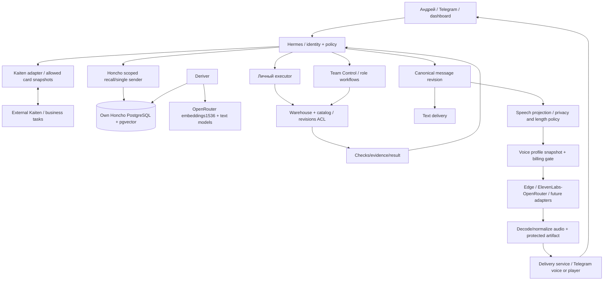
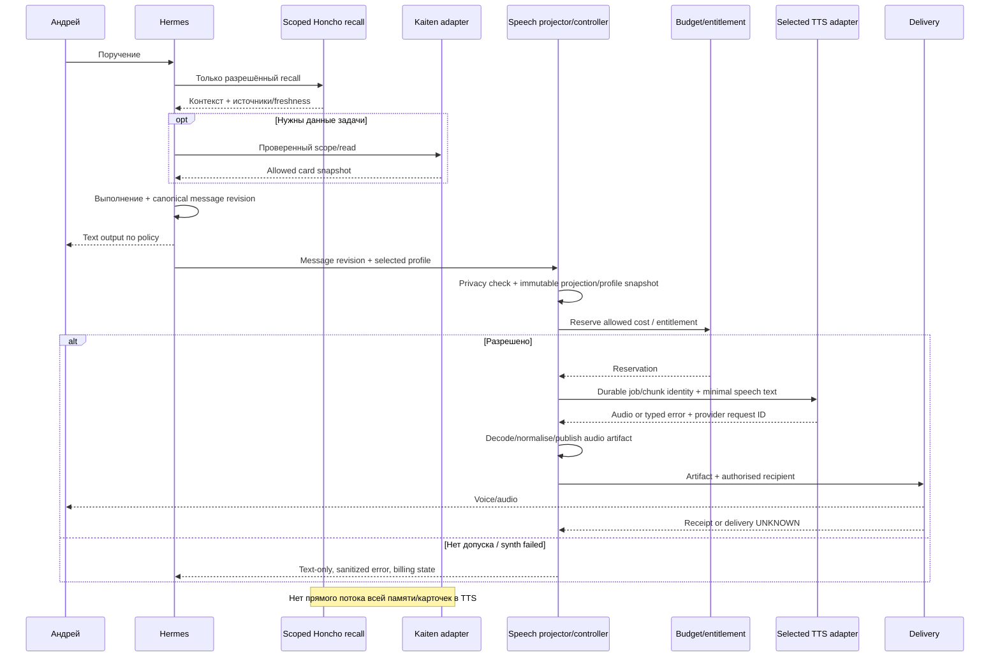
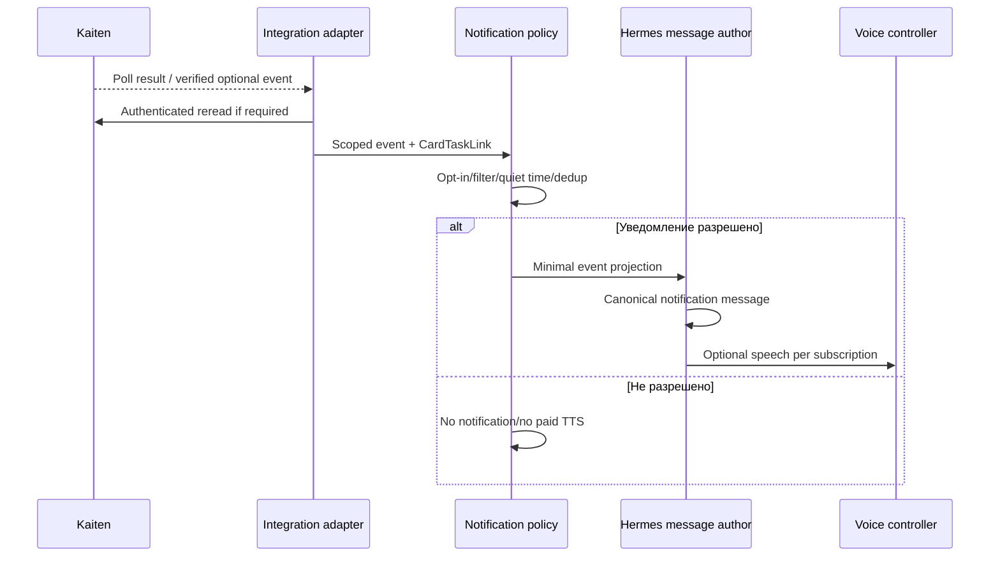

# Афина 2.0 — архитектурная спецификация 3.3
Редакция 3.3 • 04.11.2026, 22:03 МСК • Владелец решений: Андрей
Статус: консолидированная архитектура для реализации. Не отчёт о развёртывании и не разрешение на покупку/внешние записи.
Основа: GitHub Colibri1985/manus-west-consulting-research, каталог Athena_v3.2.&TTS, commit a6b081eaefc710e3fa8d7170876aea2bf57a74a9 («Athena, live! 4»). Конкретные source paths и Git blob SHA перечислены в Source_Manifest.json. Дубликат имени .md с пробелом не выбран как второй primary.
Нумерация и изложение консолидированы. Это полный самостоятельный текст целевой архитектуры, а не только дополнение по голосу. Остальные решения не пересогласовываются из-за добавления TTS.

## 1. Цель и границы версии
Афина — персональный помощник Андрея на базе Hermes Agent: диалог, голос, документы, поиск, память, собственное исполнение и координация команд. Площадка HostHatch/Docker. Старая установка не переносится вслепую; полезные данные и требования восстанавливаются после ревизии.
3.3 добавляет универсальный голосовой выход: сменные движки, версии голосовых профилей, правила выбора/оплаты/конфиденциальности, synthesis jobs и независимая доставка. Не меняет выбранную embedding-модель, роль Kaiten, границы команды и warehouse. Выбор CrewAI/CADTopo остаётся открыт. Новые сторонние мастерские не вводятся этой редакцией.
Термины «подписка» разделены: коммерческий тариф поставщика и подписка пользователя на уведомления. Они описаны отдельно. Honcho/Kaiten не становятся TTS движками: их данные поступают в разрешённый текст через Hermes и policy boundary.

## 2. Статусы, решения и фактическая готовность
[РЕШЕНИЕ] — принято Андреем. [ПРОЕКТ] — выбранная для разработки реализация, ещё не установленная. [ОТКРЫТО] — решение/проверка впереди. [ИСТОРИЯ] — старый снимок, не current VPS. [ПЕРСПЕКТИВА] — не условие первого релиза.
Доказательность: planned→designed→implemented→verified→accepted. YAML parse, HTTP200, корректный ответ LLM и end-to-end результат — разные проверки. Выпуск документов не устанавливает ПО.
Принято: own Honcho/PostgreSQL+pgvector; embeddings openai/text-embedding-3-large/OpenRouter/1536; text models Honcho через OpenRouter; nullable project и внепроектный склад; daily full image00:00 Europe/Moscow→Windows→Kingston; Kaiten как планируемая интеграция; расширяемый TTS с Edge/ElevenLabs и будущими адаптерами/собственным голосом.
Не принято автоматически: конкретные text models/тариф ElevenLabs, Fish model/voice, собственный TTS engine/GPU, точное число containers, retention/RPO/RTO. Исходные budgets: infrastructure $50–60/month, platforms/subscriptions $100–150/month совокупно, не выделенный весь бюджет TTS.

## 3. Функциональные контуры
A. Личная Афина: text/voice, approved tools, документы/архивы, память, результаты. Собственные способности не исчезают при добавлении команды.
B. Мастерская/команды: роли, handoff, attempts, проверки, budget, owner acceptance. Целевая команда не подменяется одним CLI.
C. Интеграции: Kaiten/Git/knowledge и другие отдельно разрешённые сервисы, с собственными credential boundaries.
D. Эксплуатация: provisioning/network/secrets/backup/restore/monitoring. Агент не администратор VPS.
TTS — функция доставки ответа A, а не команда B и не memory pipeline. Отказ TTS/Kaiten не должен блокировать обычное общение и сохранение локального результата. Если без обязательного источника задача невозможна, она явно BLOCKED.
Frigga/Saga/Mimir/Heimdall и dashboardv4 остаются отдельными перспективами, не готовыми ролями первого релиза. Финансовая команда допустима с собственными источниками/методологией и человеческим утверждением, без автоматических платежей.

## 4. Компоненты и предварительное размещение
|Компонент|Функция|Граница|
|---|---|---|
|athena-runtime|Hermes/gateway/dashboard по pinned release|Один active profile home, не raw DB Honcho|
|athena-executor|Личные tools/documents/code|Назначенные inputs RO, job RW|
|team-control|Task API/coordinator/adapters|Trusted grants, ledger, budget|
|project-db|Операционное состояние|Не второй native Hermes state|
|honcho-api|Приём/recall memory|Scoped bearer/private API|
|honcho-deriver|Фоновая обработка|Не process внутри main LLM|
|honcho-db|PostgreSQL+pgvector|Dedicated persistent FS|
|honcho-redis|Cache/AOF по release|Не default source of truth|
|Kaiten adapter|Read/approved writes/sync|Token только adapter|
|Voice controller/projector|Выбор profile, speech text, policy/budget/jobs|Внутри trusted runtime/integration boundary сначала|
|TTS adapter|Native Edge/custom command/plugin|Минимальный env/text, no raw task context|
|Catalog/publisher|Artifact IDs/versions/ACL/publish|Independent of Team DB|
Восемь app services — исходная ведомость до workers/proxy/catalog. TTS не требует нового постоянного контейнера автоматически. Own TTS endpoint может быть добавлен позднее отдельным ограниченным сервисом/машиной, ресурсы пока не выбраны. Native subagents Hermes не тождественны worker containers. terminal.backend=docker не равно подключённый заранее executor.
Отдельные Compose core/honcho/team, точечные API networks; existing VPN и один Caddy ИЛИ Nginx. Никаких privileged/docker.sock/general admin shell для агентов. Непривилегированные UID/GID/read-only root/cap_drop подтверждать совместимостью образа.

## 5. Сквозная архитектура данных

Стрелки — interfaces/data flow, не общий filesystem mount. Нельзя направить Honcho conclusions или Kaiten event напрямую в paid synthesis до authorisation/projection. Внешний TTS получает только одобренный speech_text, не весь prompt/память/credentials.

## 6. Источники истины и идентичность
|Данные|Primary|
|---|---|
|Native sessions/history/auth|Hermes home/state.db/native stores|
|Краткая память|Native MEMORY/USER files согласно release|
|Долговременный контекст|Own Honcho DB/API|
|Явные знания/решения|Selected primary Obsidian/Wiki + trusted Decisions|
|Business card title/due/assignees/location|Kaiten|
|TaskRevision/run/stage/attempt/checks|Internal ledger|
|Файлы|Warehouse payload + catalog metadata|
|Правила/approvals|Trusted registry|
|Speech input|Canonical MessageRevision + versioned SpeechProjection|
|Выбранный голос|VoiceSelection→immutable VoiceProfileRevision|
|Фактический звук|AudioArtifact manifest/hash/codec|
|Оплата|Billing account/reservations/settled provider usage|
Principal_id/channel binding проверены trusted ingress. Scope=environment/privacy_domain/project optional. Session ID, board URL и client header не являются правом доступа. Work/personal изоляция включает native memory и voice cache, не только Honcho sessions. Один writer home, либо поддерживаемая нативная concurrency authority, не независимые процессы в одном profile.
Kaiten hosted data не становится локальной DB. Local cache не полный backup внешней системы. Нативные схемы Hermes/Honcho/Kaiten руками не модифицируются ради новых logical entities.

## 7. Основная и вспомогательные модели
Main Hermes LLM/provider остаётся открытым выбором. Text models Honcho отдельно. Командные роли имеют approved model IDs/tool/data classes/context/cost/escalation/fallback/timeouts. Новая модель не получает больше прав. Подписка не universal API endpoint.
Requested model и actual runtime/provider различаются: учитывать фактические usage/цену. Auxiliary compression/title/audio-tags отдельные вызовы и расходы. Hidden rewrite для эмоций не включать без source mapping и policy: она не должна менять цифры/смысл.
Embeddings закрыты решением: OpenAI Text Embedding3Large/OpenRouter/1536. No vendor fallback, even same dimension. Новый embedding engine требует нового пространства/миграции. TTS voice model не замена reasoning model и не часть vector search.

## 8. Память Honcho
Self-hosted API/Deriver/PostgreSQL+pgvector/Redis. Один active external provider в Hermes, plugin совместим с pinned release. Accepted message не derived/recall-ready. Контекст ограничен по tokens/scope, provenance/freshness, contradictions не превращаются в approved rules.
Один sender/native sync authority; outbox-gap решать в том же пути, не двойной отправкой. UNKNOWN reconcile до повторного send. Corrections/tombstones/cache invalidation учитывают источники и повторное выведение. Secret scrub не complete DLP. Privatekeys/tool logs не отправляются.
Own DB не local inference: разрешённые texts уходят OpenRouter/provider. Actual single+batch embedding output1536 подтверждается в real Honcho client. Outage: optional memory→explicit degraded; required memory→blocked. Approved decision читать из trusted record, не stale recall.
TTS не пишет output audio в Honcho по умолчанию. Сохраняется один canonical conversation turn; spoken transcript/projection refs — связь, не второй дублирующий turn. Voice mood не считается психологическим фактом о пользователе. Любая preference, извлечённая из речи, проходит общую memory policy.

## 9. Kaiten: задачи и синхронизация
Статус integration planned, не recovered working connector. Adapter хранит connection/scope bindings/card refs/cursors/snapshots/operations/conflicts отдельно от native stores. Credentials в secretrefs. REST/read pagination первой стадией, webhook optional later.
CardTaskLink many-to-many с явно определённым primary publishing target. CardSnapshot immutable→proposed TaskRevision. Remote description/comment как data не trusted instruction, card move не release approval. Не every card=autoexecution и не каждый attempt новая card.
Field authority: Kaiten business fields; ledger attempts/checks/cost. Update reread/base-diff/patch owned fields; human edit conflict не last-writer-wins. Remote optimistic concurrency/idempotency только если проверены endpoint guarantees. POST timeout→UNKNOWN→reconcile, no blind duplicate create/comment.
Получение boardmetadata не даёт все cards, использовать documented paginated cards query до complete scan. Missing on incomplete page не deletion. Webhooks не trusted commands; verify supported source authentication, reread authenticated REST, dedup по доступным IDs/fingerprint, prevent echo loop.
TTS результата не добавляет audio attachment/comment в Kaiten автоматически. Это отдельный publish operation с data/access/approval policy. Public share/private VPS path не создаются как «готовая ссылка» без согласованной доставки.

## 10. Warehouse, lifecycle и роли исполнения
Категории: intake, standalone, one-off, library, projects, conversation-media. Project может отсутствовать. Пользовательские административные документы отделены от runbooks, deployment, governance и secrets. ArtifactRevision неизменяема; hash и provenance вычисляются при публикации. Ссылки из задач не создают независимые редактируемые копии.
Маршрутизация выполняется при поступлении, архивирование — отдельный статус по основанию. Other не означает бесконтрольную папку «Разное». Подозрительные файлы ограничиваются, зашифрованные не считаются обработанными, дубликаты сохраняют сведения о поступлении. Внешнесвязанные Excel-комплекты не переименовываются автоматически. Hold запрещает удаление. Work cleanup разрешён только после terminal state, публикации нужных результатов и проверки leases/refs по утверждённой retention policy. Числовые сроки пока открыты.
Skill — процедура; tool — действие; role — ответственность; memory — контекст. Реестр фиксирует версии, source/hash, зависимости, scopes, model policy и тесты. Массовая установка packs и самостоятельное изменение approved skills без policy не допускаются.
Каталог ролей: PM, BA, SA, Architect, 1C Analyst по scope, UX, Developer, Data Engineer, QA, Reviewer, Git Manager, DevOps/Release, Coordinator. Software, analytical и finance — разные маршруты. Handoff содержит TaskRevision, attempt, bundle, snapshots, criteria, checks, ограничения и следующего владельца. Durable intent, receiver receipt и execution — разные события. Stale fencing/revision отклоняются; повторы и стоимость ограничены; неизвестный внешний эффект требует reconcile. Независимый QA, приёмка владельцем и release approval разделены.

## 11. Документы, STT, TTS и realtime
Поддержка Office/PDF/CSV/Markdown и архивов подтверждается сквозными сценариями. ZIP/RAR/7z требуют квот, проверки путей и symlinks, запрета auto-execute. Сложные Excel/PQ/Pivot/VBA и внешние связи не пересохраняются сторонним движком без доказанной сохранности. Native Windows/Excel runner — отдельное решение; строка формулы не доказывает вычисленное значение.
STT: audio → transcript. TTS: text → audio. Transport: доставка. Realtime: микрофон, воспроизведение, прерывание и жизненный цикл потока. Редакция3.3 утверждает сменный TTS, а не автоматически новую STT или full-duplex Mini App. Существующий STT не меняется ради выбора голоса.
Пользовательский текст остаётся доступным при ошибке синтеза. Telegram voice не гарантирует autoplay. Непрерывный разговор требует отдельного feasibility test, без обязательного перехода в другой messenger.

## 12. Универсальная TTS-подсистема
Общий контракт: разрешённый текст + snapshot профиля + формат результата → audio result или типизированная ошибка. Backend adapters: встроенный Edge, ElevenLabs через OpenRouter, возможный direct ElevenLabs, будущий Fish и собственный endpoint. Добавление движка не переписывает агентский turn handling и доставку.
VoiceEngineRevision описывает transport/model/capabilities/auth routing. VoiceIdentityRevision — узнаваемый голос, voice ID и материалы. VoiceProfileRevision фиксирует engine + identity + язык + style/format/policy/billing. Один движок может иметь несколько профилей; переносимость одного голоса между движками не предполагается.
Capabilities задаются отдельно: whole_file, stream_pcm, list_voices, instructions, speed, cloning, locality. Неподдерживаемые параметры отклоняются либо соответствующая настройка отключена; нельзя молча игнорировать выбор пользователя. Fallback не расширяет передачу данных и не меняет голос неожиданно.
Первый этап — whole-file reply. Реальное streaming позже требует plugin interface, ограниченного PCM buffer и точных sample_rate/channels/encoding/timebase. HTTP byte stream не равнозначен непрерывному разговору. Command idle timeout не заменяет общий deadline job.

## 13. Голосовые профили и переключение
|Профиль|Backend|Статус активации|
|---|---|---|
|svetlana|Edge online, ru-RU-SvetlanaNeural|Начальная конфигурация; работоспособность проверяется на сервере|
|athena_natural|ElevenLabs через OpenRouter; elevenlabs/eleven-v4-turbo — стартовый кандидат|Нужны выбранный voice ID, доступ аккаунта, бюджет и тест|
|athena_elevenlabs_direct|Прямой ElevenLabs API|Зарезервирован, тариф не выбран|
|athena_fish|Отдельный согласованный Fish route|Модель и голос пока не выбраны|
|athena_own|Собственный локальный/серверный движок|Архитектурная возможность, ресурсы открыты|

Контроллер проверяет права инициатора, expected_version, готовность профиля, capabilities, права на голос и бюджет. Затем атомарно создаёт новую ревизию выбора. Каждый ответ фиксирует неизменяемый snapshot профиля до синтеза. Уже выполняющийся ответ не меняет голос посередине фразы или между чанками.
Первый scope выбора — профиль Hermes. Переключение на уровне чата возможно только после реализации отдельного mapping и передачи выбора в каждый запрос. Нельзя обслуживать параллельные чаты конкурентным редактированием одного глобального config.yaml.
Желаемый UI — переключатель готовых профилей. На первом этапе допускается изменение tts.provider с поддерживаемым reload/restart и readback. Горячее переключение не объявляется существующей функцией. Speech off — режим вывода, а не несуществующий native provider:none. При неготовом платном профиле исходный выбор не меняется молча.

## 14. Собственный голос Афины
Архитектура допускает референсные записи, расшифровки, speaker prompts/embeddings, адаптеры и специально подготовленные веса модели. Для каждого материала фиксируются источник, право использования, согласие при необходимости, лицензия, hash и версия. Право воспроизводить запись не означает право обучать на ней другую модель или экспортировать сервисный voice clone.
Создание собственного голоса не входит автоматически в первый этап. Движок, метод подготовки, исполнитель, вычислительная среда и ресурсы выбираются отдельно. Возможные источники — собственный voice design в разрешённой системе либо записи диктора с необходимыми правами.
Результаты ElevenLabs не используются для подготовки другой AI-модели в обход условий поставщика. Не предполагается, что платная подписка разрешает такое использование. При необходимости отдельное разрешение подтверждается до обработки.
Идентичность голоса и манера речи разделены. Один нейтральный референс не гарантирует все эмоции; перенос между движками не обещает идентичного звучания. Возможности задаются capability-контрактом.
Создание/дообучение и ежедневный inference требуют разных ресурсов. Голосовые активы хранятся в постоянном хранилище с backup, а не в work/cache. Отзыв права блокирует новые задания и повторное воспроизведение из кеша; судьба истории и резервных копий определяется отдельной политикой.

## 15. Коммерческие подписки, биллинг и разрешение затрат
Коммерческий тариф и голосовой профиль — разные сущности. Используются BillingAccount, EntitlementRevision, RateCardRevision, BudgetReservation и SpeechUsage. Маршрут профиля определяет, какой аккаунт действительно оплачивает запрос.
|Маршрут|Источник оплаты|Credentials|Не предполагается|
|---|---|---|---|
|Edge|Без API-платы в исходной схеме|API-ключ не нужен|Офлайн-работа, бессрочный SLA или гарантированный безлимит|
|OpenRouter → ElevenLabs|Баланс и фактическое использование OpenRouter|OpenRouter TTS key|Прямая подписка ElevenLabs не пополняет OpenRouter|
|Прямой ElevenLabs|Действующий план/PAYG/квоты аккаунта|ElevenLabs key|OpenRouter key не заменяет его|
|BYOK через маршрутизатор|Условия конкретного поддерживаемого BYOK-маршрута|Согласованные credentials|Отсутствие комиссий и двойного учёта без проверки|
|Fish|Выбранный прямой или посреднический маршрут|Собственный credential ref|Автоматически выбранная бесплатная модель|
|Собственный движок|Вычисления, хостинг, лицензии|Локальный scoped auth при необходимости|Нулевая стоимость или достаточность текущего VPS|

Цены хранятся в versioned RateCard, а не зашиваются в архитектуру. Единицы — символы, токены, секунды или кредиты — определяются фактическим маршрутом. Валюта, налоги, комиссии и конвертация кредитов учитываются явно. Квота тарифа и API rate limit не смешиваются.
До dispatch резервируется верхняя расчётная стоимость с учётом чанков и применимых тарифов. Лимиты периода и параллельности проверяются атомарно. Это локальный admission guard, не гарантия мгновенного внешнего списания или остановки начатого запроса. Provider-side spend limits используются, если поддерживаются.
Если платный бюджет не утверждён, monthly_limit=null означает BLOCKED, а не «безлимит». Одного ATHENA_PAID_TTS_ENABLED=true недостаточно для утверждения месячного бюджета. Автопокупка или upgrade подписки запрещены без решения владельца.
Учитываются previews, повторные вызовы, style tags, вспомогательная LLM-нормализация и собственные вычисления. Таймаут может оставить стоимость UNKNOWN. Резерв не освобождается как «не потраченный» без сверки. На OpenRouter сохраняется X-Generation-Id, если получен; окончательная стоимость сверяется доступным provider usage/billing механизмом, а не выдумывается по MP3.

## 16. Подписки на уведомления
NotificationSubscription определяет principal, scope, типы событий, источник/board/task filters, канал, проверенного получателя, режим озвучивания, правило выбора профиля, quiet hours, cadence и статус. Это не коммерческая подписка.
По умолчанию каждое техническое событие не озвучивается. Пользователь явно включает нужные категории: задача завершена, требуется ответ, критический сбой. Получатель назначается доверенной стороной; его нельзя подменить полем карточки.
Дедупликация использует event revision, recipient, channel и revision подписки. Частые технические обновления можно агрегировать. Точные расписания и quiet hours согласуются отдельно.
Kaiten event → проверка/REST reread → разрешённая проекция события → сообщение Hermes → optional TTS. Событие обработки памяти Honcho само по себе не создаёт уведомление. Смена профиля или ошибка TTS не запускает рекурсивную цепочку голосовых оповещений.

## 17. Проекция текста для речи и приватность
Canonical MessageRevision — неизменяемый текст ответа или утверждённого уведомления. SpeechProjection хранит произносимый текст, версию преобразования, ссылки на источники и hash. Видимый текст не перезаписывается скрытым TTS preprocessing.
Данные Honcho и Kaiten проходят read ACL, минимизацию и формирование ответа до TTS. Право прочитать рабочую карточку не означает право передать её внешнему голосовому провайдеру. Для каждого облачного маршрута проверяются допустимые классы данных и условия поставщика. Edge тоже является внешней обработкой.
Режимы: off, mirror_text, concise_summary. Краткая озвучка — отдельная проекция с обозначенными ограничениями, не тихое обрезание текста. Нормализация чисел, валют, дат, отрицаний и идентификаторов не меняет смысл. Примеры «1С», «БИТ.Финанс», суммы и проценты входят в приёмку.
Недоверенный текст карточки может содержать markup, audio tags или инструкции. Они не становятся командами движку. Style instructions поступают только из разрешённого профиля. Внешнему TTS не отправляются полный prompt, memory store, credentials, внутренние логи или скрытая история.

## 18. Спецификация API синтеза речи
Ниже проектный API Афины, не native endpoints Hermes или Honcho. Он может быть реализован закрытым HTTP-сервисом, Unix-каналом или in-process фасадом. Новый публичный порт не требуется. У исходящего сообщения только один владелец автоозвучки: native handler либо контроллер, но не оба параллельно.
Общий интерфейс адаптера: synthesize(SynthesisRequest, scoped_dependencies) → SynthesisResult. Разрешённый запрос содержит message/projection/profile revisions и формат доставки. Provider URL, ключи, произвольный output path и shell template от клиента не принимаются.
|Method/path|Результат|Gate|
|---|---|---|
|GET /athena/v1/voice/profiles|Доступные профили и capabilities|ACL до metadata, без секретов|
|GET /athena/v1/voice/selection|Текущий разрешённый выбор|Scope check, без секретов|
|PUT /athena/v1/voice/selection|Новая selection revision|Trusted actor, expected_version, readiness|
|POST /athena/v1/tts/jobs|Durable job receipt|ACL, privacy, entitlement, budget, idempotency|
|GET /athena/v1/tts/jobs/{id}|Состояния, ошибки, usage, artifact refs|Owner/scope check|
|POST /athena/v1/tts/jobs/{id}/cancel|Cancel request|Expected version; no refund promise|
|GET /athena/v1/tts/jobs/{id}/audio|Проверенные аудиобайты|READY, live access/rights, retention|
|POST /athena/v1/voice/previews|Preview job|Разрешённый короткий текст и отдельный paid budget|
|POST /athena/v1/deliveries|Delivery receipt|Разрешённый target и существующий artifact|
|GET /athena/v1/deliveries/{id}|Delivery state/receipt|Scope check|

Внешний клиент передаёт message_revision_id, а не неограниченный сырой текст. Доверенный internal preview может содержать synthetic text после той же проверки. Схема OpenAPI поставляется как design contract; API-сервер этим документом не создан.

## 19. Примеры API и идемпотентность
```http
POST /athena/v1/tts/jobs
Authorization: Bearer <internal-scoped-token>
Idempotency-Key: <unique-operation-key>
Content-Type: application/json
```
```json
{"message_revision_id":"msg-042-r1","profile_id":"athena_natural","delivery_format":"telegram_voice"}
```
Profile ID — разрешённый выбор, не обход selection policy. Principal/scope берутся из проверенной identity. Сервер фиксирует разрешённую projection и profile revision. Hash исполнения включает engine/model/voice/format/policy, но повтор того же клиентского ключа сначала находит прежнее разрешение, не пересчитывает его по новому default voice.
Одинаковые key+actor+request возвращают прежний receipt. Иное тело с тем же key — 409. Истёкший кеш не даёт права автоматически повторно оплачивать прежнюю бизнес-операцию. Срок хранения idempotency records согласуется отдельно.
```json
{"job_id":"speech-042","status":"queued","profile_revision":"athena_natural:r1","billing_status":"reserved","delivery_status":"not_requested"}
```
202 означает локально сохранённое принятие, не успешный синтез или доставку. GET при READY возвращает audio_artifact_id, sha256, codec/container, duration/sample_rate/channels и billing status. Сырые пути хоста, ключи и provider error bodies не возвращаются.
POST synth не отправляет голосовое автоматически. Delivery использует отдельный idempotency key и уже готовый artifact; сбой транспорта не повод снова вызвать платную модель.

## 20. Контракты внешних TTS-адаптеров
|Backend|Запрос|Особенности|
|---|---|---|
|Edge|Штатный Hermes adapter/library|Онлайн Microsoft; стабильный публичный REST contract не выдумывается|
|OpenRouter|POST https://openrouter.ai/api/v1/audio/speech; Bearer; model/input/voice/response_format|Raw MP3/PCM, не JSON; X-Generation-Id при наличии|
|ElevenLabs direct|Поддерживаемый SDK или native Hermes provider|Отдельные model IDs, voice IDs, key и entitlement|
|Fish direct|POST https://api.fish.audio/v1/tts; Bearer; model header; text/reference_id/format|Неизвестный model header отклоняется локально до запроса|
|Own engine|Versioned private API/command/plugin|Явные codec/capabilities/rights/auth/resource limits|

Начальный OpenRouter-профиль запрашивает MP3 явно. Для PCM обязательны фактические sample rate, channels, sample format и endianness. Неверный rate меняет скорость и высоту воспроизведения. Не отправлять speed/instructions, если модель их не поддерживает.
Правила маршрутизации speech не считаются идентичными chat routing. Privacy requirements сверяются по capabilities реального endpoint. Ключи прямого провайдера и OpenRouter невзаимозаменяемы.
Reference upload — только с правами, scoped access и ограничением размера. Произвольные URL не скачиваются без anti-SSRF/allowlist. Модель/voice/rate card закреплены revision и проверяются при активации.
На выходе проверяются HTTP status, bounded bytes, MIME, декодирование и ffprobe. Extension не доказательство codec. Для Telegram source MP3 конвертируется в Opus/OGG; raw PCM нельзя переименовать в MP3.

## 21. Состояния заданий, чанки и доставка
Synthesis: CREATED → VALIDATING → QUEUED → DISPATCH_INTENT → SYNTHESIZING → AUDIO_VALIDATING → READY. Дополнительные состояния: FAILED, BLOCKED, PARTIAL, CANCEL_REQUESTED, CANCELLED, OUTCOME_UNKNOWN.
Billing: not_required/reserved/settled/unknown. Delivery: not_requested/queued/sending/delivered/failed/unknown. Эти оси независимы: звук может быть готов, но не доставлен; запрос мог быть оплачен без пригодного аудио.
План чанков неизменяем: порядок, text digests, profile snapshot. На чанк выделяется attempt и provider request reference. Параллельность ограничена. Уже готовые чанки не перегенерируются из-за сбоя доставки. Неполная запись отмечается как PARTIAL, полный текст остаётся доступным.
Отмена queued job не вызывает provider. Отмена running — best effort, не гарантирует отсутствие списания. Unknown billing не превращается в ноль и не освобождает резерв до сверки. Продолжение после ошибки не меняет voice revision незаметно.
При потере channel receipt возможна уже выполненная доставка. Используется доступная сверка, а не выдуманная exactly-once гарантия Telegram. Успешная BusinessTask не становится FAILED только из-за синтеза или отправки голоса.

## 22. Хранение конфигов, голосовых материалов и кеша
```text
/srv/athena/deployment/core/voice/        # managed code, schemas, templates
/srv/athena/state/hermes/<profile>/
  config.yaml                           # native provider binding
  .env                                  # runtime secrets, 0600
  honcho.json                           # отдельное подключение памяти
/srv/athena/state/voice/                 # selections, jobs, receipts, budget refs
/srv/athena/model-assets/voice/<identity>/<revision>/
  reference.* / transcript.txt / rights.json / manifest.json
/srv/athena/work/tts/<job>/<chunk>/       # временные ограниченные файлы
/srv/athena/warehouse/media/generated/tts/ # retained audio при необходимости
/etc/athena/secrets/                     # provider credentials
```
Code/templates read-only, mutable state имеет одного владельца. Registry версионируется; выбор меняется через CAS. Секреты не находятся в профилях Git, карточках или памяти. env_passthrough — явное разрешение переменных, не полная ОС-изоляция процесса.
Cache key включает principal/environment/domain, разрешённую projection, engine/model/voice/profile versions, style, normalizer, codec и policy/rights revision. Нельзя переиспользовать аудио между scopes только из-за одинакового текста. Для короткого чувствительного текста обычный hash не анонимизация; использовать scoped HMAC и защищённые metadata.
Перед playback повторно проверяются доступ и отзыв прав. Numeric TTL и retention для voice assets, job receipts, audio и usage согласуются отдельно. Temporary cleanup не удаляет активные чанки и единственный экземпляр референса. Regeneration кеша может стоить денег.
Backup включает профили, выбор, права, manifests, нужный job state и защищённые secrets. Ключ восстановления хранится вне VPS. Акустические референсы не смешиваются с API credentials.

## 23. Реестр профилей: наш контракт, не native Hermes
```yaml
schema_version: '3.3'
selection:
  scope: hermes_profile
  active_profile: svetlana
  version: 1
  switch_policy: next_reply
  fallback_policy: text_only
profiles:
  svetlana:
    revision: 1
    enabled: true
    hermes_provider: edge
    engine: edge_online
    voice: ru-RU-SvetlanaNeural
    external_processing: true
    billing_route: no_api_charge
  athena_natural:
    revision: 1
    enabled: false
    hermes_provider: athena_elevenlabs
    engine: elevenlabs_via_openrouter
    model: elevenlabs/eleven-v4-turbo
    voice: null
    credential_ref: openrouter_tts
    billing_account_ref: openrouter_main
    external_processing: true
    activation_requires:
    - chosen_voice
    - paid_budget
    - account_access
    - synthesis_delivery_test
  athena_fish:
    revision: 1
    enabled: false
    engine: fish_direct
    model: null
    voice: null
    activation_requires:
    - model_selection
    - chosen_voice
    - paid_budget
    - synthesis_delivery_test
  athena_own:
    revision: 1
    enabled: false
    engine: null
    voice_identity_revision: null
    locality: undecided
    activation_requires:
    - engine_selection
    - resources
    - rights_check
    - synthesis_delivery_test
  athena_elevenlabs_direct:
    revision: 1
    enabled: false
    engine: elevenlabs_direct
    model: null
    voice: null
    credential_ref: elevenlabs_direct
    external_processing: true
    activation_requires:
    - account_plan_selection
    - chosen_voice
    - paid_budget
    - synthesis_delivery_test
```
Это проектный реестр3.3. Он не изменяет Hermes без controller/selector. Миграция registry сохраняет действующие профили и не включает записи с enabled=false. Источник фактического native выбора — effective config. Несовпадение registry и readback создаёт drift alert. Все paid-профили остаются заблокированными до voice/key/budget и приёмочного теста.

## 24. Native Hermes config и секреты
```yaml
# Фрагмент, слить в существующий config.yaml, не два tts ключа.
tts:
  provider: edge
  speed: 1.0
  edge:
    voice: ru-RU-SvetlanaNeural
    speed: 1.0
    max_text_length: 4000
  providers:
    athena_elevenlabs:
      type: command
      command: >-
        python3 /opt/athena/voice/tts_adapter.py
        --backend openrouter --input {input_path} --output {output_path}
        --model {model} --voice {voice}
      model: elevenlabs/eleven-v4-turbo
      voice: REPLACE_WITH_CHOSEN_ELEVENLABS_VOICE_ID
      output_format: mp3
      voice_compatible: true
      timeout: 90
      max_text_length: 4000
      env_passthrough:
        - OPENROUTER_TTS_API_KEY
        - ATHENA_PAID_TTS_ENABLED
        - ATHENA_TTS_MAX_INPUT_CHARS
```
```dotenv
OPENROUTER_TTS_API_KEY=
FISH_TTS_API_KEY=
ATHENA_PAID_TTS_ENABLED=false
ATHENA_TTS_MAX_INPUT_CHARS=4000
```
4000 символов и90 секунд — исходные проектные параметры, не месячный финансовый лимит. Native command timeout относится к отсутствию вывода; HTTP socket timeout60s в образце не является строгим общим deadline. Общий deadline и quota controller должны быть реализованы отдельно.
Command stdout/stderr может возвращаться модели, поэтому в нём запрещены секреты, полный текст и raw provider error bodies. Source adapter проверяет key/model/voice, размер и MIME, блокирует redirects, пишет atomic output и не делает auto-retry. Он не реализует selector, monthly reservations, decode validation, cache, delivery ledger и streaming. Для plugin streaming отдельно проверяется потокобезопасность. Custom providers не должны подменять встроенные имена.
В комплекте native-фрагмент показывает Edge и ElevenLabs/OpenRouter. Fish/direct ElevenLabs/own engine пока зарезервированы в registry, не объявляются установленными provider bindings.

## 25. Логическая модель данных 3.3
53 сущности 3.2 сохраняются по назначению: identity/scopes/projects; tasks/revisions/runs/stages/attempts/handoff/checks; artifacts/revisions/links/locations; governance/approval/roles/skills/model policy; inbox/outbox/audit/memory integration; budgets/usage/backup; десять сущностей Kaiten.
Добавляются 16 сущностей: VoiceEngineRevision, VoiceIdentityRevision, VoiceMaterial, VoiceProfileRevision, VoiceSelection, MessageRevision, SpeechProjection, SynthesisJob, SynthesisChunk, AudioArtifact, DeliveryAttempt, BillingAccount, EntitlementRevision, RateCardRevision, SpeechUsage и NotificationSubscription.
Engine хранит route/capabilities/version, identity — ссылки на разрешённые материалы, profile закрепляет их версии. Selection указывает конкретный profile revision. MessageRevision — canonical text и source refs; Projection — spoken text/transform/hash; Job — snapshot/idempotency/reservation; Chunk — порядок/attempt/provider receipt; AudioArtifact — verified ArtifactRevision+codec; DeliveryAttempt — exact target/channel receipt.
BudgetReservation расширяется: subject_kind/subject_ref поддерживают execution attempt либо synthesis job. Для голосового ответа не требуется создавать фиктивный BusinessTask или attempt. BillingAccount отражает путь оплаты, а не заменяет внутренний BudgetAccount. Provider balance cache имеет fetched_at и не выдаётся за банковский источник истины.
NotificationSubscription хранит scopes, события, получателя и selector. Все межхранилищные связи — logical references, не SQL foreign keys внутри Honcho/Kaiten. Новая DDL ещё не применяется. Озвучивание не меняет BusinessTask acceptance.

## 26. Матрица ошибок и правила эскалации

| Код                                       | Действие                                                | Повтор и эскалация                                       |
|:------------------------------------------|:--------------------------------------------------------|:---------------------------------------------------------|
| PROFILE_NOT_READY / VOICE_NOT_CONFIGURED  | Не вызывать провайдера; сохранить текст                 | Настроить профиль, не подставлять голос по умолчанию     |
| SCOPE_DENIED / EXTERNAL_PROCESSING_DENIED | Отказать без выдачи аудио или чужого кеша               | Не переключаться на другой облачный сервис               |
| SUBSCRIPTION_INACTIVE / KEY_INVALID       | Заблокировать выбранный маршрут                         | Администратор; без автоматической покупки                |
| BUDGET_NOT_APPROVED / BUDGET_EXCEEDED     | Не выполнять новый платный вызов                        | Решение владельца либо text-only                         |
| RATE_LIMITED                              | Ограниченное ожидание в рамках deadline                 | Retry-After и проверка receipt, без бесконечных повторов |
| PROVIDER_NETWORK_TIMEOUT                  | Исполнение и стоимость могут быть UNKNOWN               | Reconcile до повторного платного запроса                 |
| MODEL_UNAVAILABLE / UNSUPPORTED_OPTION    | Отклонить точный профиль или опцию                      | Не менять модель/голос молча                             |
| INVALID_AUDIO / EMPTY_AUDIO               | Не отправлять повреждённый результат                    | Внешний запрос мог быть оплачен; отдельная сверка        |
| CONVERSION_FAILED                         | Ограниченно сохранить валидный исходный звук            | Повторить локальное преобразование, не синтез            |
| DELIVERY_FAILED                           | Готовность аудио не сбрасывать                          | Повторить разрешённую доставку готового artifact         |
| DELIVERY_OUTCOME_UNKNOWN                  | Не объявлять сообщение недоставленным                   | Сверка доступного канального receipt                     |
| PARTIAL_SYNTHESIS                         | Явно обозначить неполную озвучку; полный текст доступен | Продолжение по policy без смены голоса                   |
| STORAGE_FULL / MOUNT_MISSING              | Остановить новые записи; mount guard                    | Оператор; не создавать пустую БД на rootfs               |
| PROFILE_REVOKED / RIGHTS_REVOKED          | Запретить новые jobs и выдачу кеша                      | Проверка прав и lifecycle                                |
| CANCELLED                                 | Не возобновлять автоматически под другим профилем       | Указать возможное списание                               |
| HONCHO_UNAVAILABLE / KAITEN_UNAVAILABLE   | Обязательный источник — block; иначе явный degraded     | Не ошибка TTS; не выдумывать контекст                    |

Ошибки возвращают безопасные code, job_id, correlation_id и retry classification, без ключей, полного текста и raw provider traceback. Успешная задача не становится FAILED из-за озвучки. Callback-исключение не отменяет внешние эффекты.

## 27. Безопасность и границы контекста
Авторизация выполняется до listing, preview и audio fetch. Знание UUID не является доступом. Кеш и голосовые материалы наследуют privacy domain и проверяют отзыв прав.
Read permission не равно external-processing permission. Нельзя передать запрещённые персональные/медицинские/платёжные данные в облако под видом «просто озвучить». Для local-only данных Edge также не подходит, поскольку является внешним сервисом.
Optional SDK input_filter/nesting не ограничивает shared dependencies, tools или server-side conversation history. Handoff минимален; tool broker применяет live grants. Secret canaries проверяются в model input, child env, logs и streams.
Служебные DB/cache/metrics не публикуются. Proxy один, private/loopback endpoints, IPv4/IPv6 проверяются отдельно. Docker firewall backend определяется фактически; UFW не считается единственной защитой опубликованных портов. Никакого docker.sock агентам.
Endpoint и shell template — trusted config. Redirect/reference fetch ограничены anti-SSRF. Права на голос и допустимость клонирования проверяются до обработки, а не после создания модели. Удаление/отзыв прав и backup retention — отдельные согласованные процедуры.

## 28. Логи, backup и восстановление
Один primary на каждый класс данных. Honcho использует dedicated filesystem/UUID, mount доступен до auto-restart контейнеров. External named volume сам по себе не доказывает отдельный диск. Образы и Docker logs могут находиться вне этого тома.
Проектная ротация: local driver 10m × 5 с compression; это size retention, не гарантированные дни хранения. PostgreSQL stderr без дублирующего collector. Proxy/journal/file logs ограничиваются отдельно. Raw SQL, spoken text, audio base64, Authorization и ключи не попадают в обычный журнал ошибок.
Согласованный full image — ежедневно в 00:00 Europe/Moscow, все требуемые диски; затем Windows → Kingston и isolated restore. Preupgrade pg_dump дополняется roles/extensions/config/secrets. Hash или archive list не заменяет restore test. Hosted Kaiten и provider Voice Library не входят в VPS image: экспорт и права отдельно.
После восстановления интеграции сначала сверяют current remote state и pending intents в read-only режиме. Нельзя автоматически повторить озвучку или публикацию из старого outbox без проверки receipts. Voice assets/rights — обязательная часть защиты; cache regeneration допускается только с учётом цены. RPO/RTO и retention остаются открытыми.

## 29. Deployment и миграция 3.2 → 3.3
Новый постоянный TTS-контейнер необязателен. Сначала native Edge и command adapter в управляемом образе, controller/job store в trusted runtime/integration boundary. Shared TTS service или own engine выделяются позднее по ADR. GPU и соответствие CPU-only VPS не предполагаются.
Шаги: сохранить effective 3.2 config/assets/receipts; проверить pinned versions; зарегистрировать новые профили с paid disabled; сохранить Edge; применить транзакционную миграцию voice state; создать selection revision; проверить synthetic Edge/codec/delivery; отдельно разрешить один paid preview; активировать выбранный профиль; readback и тест next-reply snapshot; записать evidence.
В config.yaml сливается одна tts-секция, остальные настройки сохраняются. Исходный registry v1 был описательным, а не работающим selector. Source adapter не запускается при выпуске документа.
CI: reviewed commits/actions, минимальные permissions, нет prod secrets в PR, build once/pinned digest, staging. CD: exact owner approval, UUID/backup checks, один migration owner, functional tests и rollback. Restricted root dispatcher не заменяется общим sudo или docker group.
Rollback требует сохранения схемы/конфига/selection revisions. При восстановлении старой БД возможные новые списания и доставки не исчезают — их необходимо сверить. Purchase, тариф, voice selection и собственное оборудование отдельно согласуются.

## 30. Ресурсы и наблюдаемость
Исходный бюджет Honcho 4 vCPU / 8 GiB / 100 GiB данных сохраняется как проектный ориентир, не факт о VPS. Пример RAM: DB 3 GiB + API 1 + Deriver 1.5 + Redis 0.5 = 6 GiB контейнеров, ещё 2 GiB — резерв ОС. Core и workers требуют дополнительного бюджета. Один миллион vector(1536) — около 5.729 GiB чистых векторов, без индексов/текстов/WAL.
TTS контролирует очередь, profile/config revision и drift, availability, provider latency P50/P95, decode/conversion time, delivery receipts, unknown charges, reserved/settled usage, disk/bytes/deadline/concurrency. Полный spoken text не нужен для метрик.
Health/readiness не доказывают качество аудио. Проверяются ffmpeg/libopus, актуальный sample rate, допустимые пути, privacy и одна authority автоозвучки. Healthcheck не делает paid synthesis каждую минуту. Для полного падения VPS нужен внешний watchdog и фактически проверенная доставка alerts.

## 31. Матрица приёмки
Базовые gates: личные текст/голос/файлы до проверенного результата; auth/IPv4/IPv6; честная target-проверка Excel; memory new-session/recreate/correction; role handoff и независимый QA; snapshot-bound checks; acceptance отдельно от release; runtime grants; idempotency/unknown/restart; budgets; background work без ноутбука; persistent dependencies; full image/independent restore; requirement-to-evidence traceability; standalone без проекта/Team DB.
Kaiten gates K01–K09: scope denial; pagination; card links/snapshots; unknown write reconciliation; human edit conflict; Done не release; секреты/данные; post-restore reconcile; обычная работа при outage.
Voice gates:
|ID|Проверка|
|---|---|
|V01|Edge/Svetlana: текст → декодируемый звук → Telegram voice|
|V02|Платный профиль не вызывается без voice/key/budget|
|V03|Выбранные ElevenLabs route/model/voice доступны на аккаунте|
|V04|Смена только со следующего ответа, одинаковый snapshot всех чанков|
|V05|Неподдерживаемые style/speed не применяются молча|
|V06|Codec/container/rate проверены, нет PCM под видом MP3|
|V07|Ошибка TTS не уничтожает текст и успешную задачу|
|V08|Повтор доставки использует готовый artifact без нового синтеза|
|V09|Timeout/restart не даёт повторного неизвестного списания|
|V10|Нет scope leakage через cache/card/recall/output/logs|
|V11|Notification opt-in, quiet hours и dedup|
|V12|Нет повторной записи аудио/того же turn в Honcho|
|V13|Нет автоматической audio-публикации в Kaiten|
|V14|Voice rights, assets и restore проверены|
|V15|CAS selection и drift detection|
|V16|Overall deadline, disk/bytes и concurrency limits|
|V17|Command stdout/stderr не раскрывает private payload|
|V18|Один владелец автоозвучки, без двойного paid call|

Evidence: requirement → test → revisions → checks → decision. Неиспытанное помечается not_tested. Создание файла не подтверждает production readiness.

## 32. Последовательности голоса и уведомлений



## 33. Этапы и открытые решения
Этапы: уточнение оставшихся требований и моделей; inventory/independent copy; pinned compatibility; личная Афина; Honcho short synthetic smoke; командные контракты; параллельность/restart/cost; full backup/restore; Kaiten read/write gates; TTS profiles/paid preview/delivery policy.
TTS не задерживает установку основного текстового контура. Первый голос может оставаться Edge до готовности выбранного платного профиля.
Открыты: основная LLM Hermes; Honcho text IDs; ElevenLabs voice и account access; точный TTS budget/тариф; retention; события/quiet hours подписок; own engine/resources; реализация selector/hot reload/per-chat scope; endpoint/codec capabilities и deployment paths.
Выбранный embedding не открывается заново. Нельзя путать Honcho accepted с recall-ready, API key с per-user RBAC, Done с release approval или HTTP200 с delivered.

## 34. Изменения и границы исходного комплекта
Указанный commit проверен. Основная спецификация, ER-модель, текстовая TTS-схема, config, registry, adapter, env и README прочитаны через read-only GitHub connector. В 3.3 они использованы как содержательная основа. Это самостоятельная авторская консолидация, а не обещание побайтового сохранения каждого абзаца 3.2.
Сохранены роли Hermes/Honcho/Kaiten, task/attempt/artifact/governance/budget/backup контракты. Изменена голосовая область: общий pipeline, движки и профили, own voice capability, commercial billing и notification subscriptions, privacy projection, API/jobs/delivery, storage/errors/acceptance.
Source adapter остаётся минимальным примером. Не заявляются реализованными monthly ledger, codec validation, selector, delivery queue или streaming только потому, что они теперь специфицированы.
Git blob SHA1 не равен обычному SHA256 файла. Manifest фиксирует provenance, а контрольные суммы выпуска — целостность, не цифровую подпись. Репозиторий, сервер, Kaiten и credentials не изменены; платных вызовов не было.

## 35. Источники и статус проверки
S1. GitHub: Colibri1985/manus-west-consulting-research, commit a6b081eaefc710e3fa8d7170876aea2bf57a74a9, каталог Athena_v3.2.&TTS. Canonical paths, Git blob SHA и размеры — в Source_Manifest.json.
S2. Hermes Voice & TTS: https://hermes-agent.nousresearch.com/docs/user-guide/features/tts
S3. OpenRouter TTS: https://openrouter.ai/docs/guides/overview/multimodal/tts
S4. Fish Audio: https://docs.fish.audio/api-reference/endpoint/openapi-v1/text-to-speech
S5. ElevenLabs billing: https://elevenlabs.io/pricing/api
S6. ElevenLabs use policy: https://elevenlabs.io/use-policy
Источники проверены 04.11.2026. Тарифы, модели и API capabilities повторно проверяются на выбранном release/account. /athena/v1, registry schema и новые сущности — проектные контракты, не уже работающие endpoints. Платная генерация, установленный Hermes, VPS и Mermaid renderer в рамках этого выпуска не запускались.

## 36. Комплект поставки и согласованность моделей
Основной полный текст — Athena_2_0_Current_Specification_v3_3.md, Word DOCX и Word DOC содержат тот же нормативный текст. PDF — дополнительная версия чтения. Шесть Mermaid-файлов: versioned overview и01_Architecture.mmd идентичны;02 — physical;03 — data;04 — logical ER;05 — workflow. PNG архитектуры и группированной ER показывают актуальную3.3.
ВER сохранены53 исходные сущности3.2 и64 исходные логические связи по назначению (одна кардинальность budget уточнена для nullable attempt); добавлены16 сущностей голоса. BudgetReservation поддерживает subject_kind/subject_ref: ровно один субъект execution_attempt либо synthesis_job, никаких фиктивных tasks для обычной озвучки. Native schemas не изменяются этими файлами.
Все новые endpoints из раздела18 являются проектным private API Афины, а не уже доступными маршрутами Hermes/Honcho. Единственный canonical synthesis route — POST /athena/v1/tts/jobs. Вариант /voice/syntheses из обсуждений не вводится параллельно.
Внутренний config registry, нативный tts.provider и будущая кнопка UI — разные уровни. После изменения selection требуется effective readback; scope переключения на старте hermes_profile, hot reload/per-chat не заявлены готовыми. Файлы profile/policy в комплекте — конфигурационные контракты, не работающий controller.
Source_Manifest.json фиксирует commit и происхождение. Прилагаемый полный3.3.md использован целиком, без усечения. Сверка с3.2 является содержательной, не побайтовым доказательством сохранения всех его абзацев. Состав всех53 базовых сущностей и64 связей проверен по source ER и dictionary закреплённого commit.
Документ/схемы/файлы созданы локально. Ни VPS, ни репозиторий, ни подписки, ни карточки не изменены. Не выполнены платные calls или integration tests установленного Hermes. Mermaid CLI renderer не запускался; PNG строятся из тех же описаний узлов/сущностей отдельно. DOC — дополнительная Word-совместимая RTF-версия для открытия в Word, не бинарный Word97. Основной редактируемый формат — DOCX. Ограничение формата явно указано в README.
