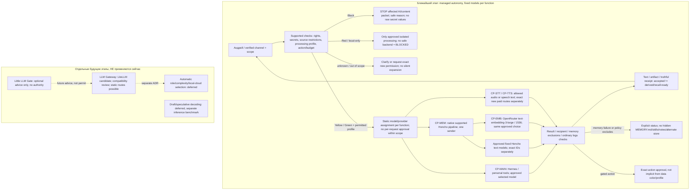

# Афина — ACP-SEC-001 r2

Дата: 05.11.2026. Статус: архитектурная политика принята в указанном объёме; implementation NOT_VERIFIED.

Утверждение: 05.11.2026 12:52 MSK (UTC+03:00).

## Содержание

1. ACP-SEC-001 r2 — уточнённая редакция
2. Запись решения владельца и предел полномочий
3. Решения D01–D10: статус в редакции r2
4. Правила Black и Red
5. Правила Yellow и Green
6. Профили облачной обработки и независимые пометки
7. Honcho: штатный режим и точечные исключения
8. Модели, Gate и Gateway: ближайший этап
9. Схема ближайшего потока и отложенных возможностей
10. Изменения CR01–CR08: уточнённый объём
11. Изменения CR09–CR16: что отложено
12. Приёмка: применимость SEC01–SEC16
13. Фазы, риски и открытые настройки
14. Совместимость редакций и что не изменено
15. Источники и воспроизводимость решения

## 1. ACP-SEC-001 r2 — уточнённая редакция

Афина 2.0 • Управляемая автономность • 05.11.2026

> Статус: архитектурная политика ПРИНЯТА в объёме SEC-MODEL-REVIEW-001 r1. Утверждение владельца: 05.11.2026 12:52 MSK (UTC+03:00). Техническая реализация, применённые настройки и испытания НЕ подтверждены этим решением.

### Принятое направление

Афина использует заранее одобренные сервисы для согласованных категорий данных без подтверждения каждого запроса. Секреты исключены из AI-контекста; local-only и запрет памяти соблюдаются. Новые назначения передачи и gated actions требуют отдельного разрешения. Honcho работает штатным поддерживаемым способом, без скрытых альтернативных stores. Дополнительные Gate/gateway внедряются поэтапно.

### Отличия от r1

• Yellow допускает standing approved profiles; обязательное обезличивание и разовое approval каждого сообщения больше не являются общим требованием.

• Сохраняем Honcho engine и embedding1536. Добавляем исключения, а не строим вторую memory subsystem.

• Ближайший этап: fixed models per function; без automatic role/complexity/local-cloud model selection.

• Gateway отложен до отдельного этапа. Little LLM Gate и draft/speculative decoding сейчас не используются.

• Сохраняем границы прав, безопасные статусы и проверки включаемых функций, но не делаем полный enterprise security-plane prerequisite полезного запуска.

### Область действия редакции

r2 заменяет противоречащие ей требования r1 о Yellow, старте gateway, объёме Honcho-доработок и rollout. Согласованные service boundaries и A02 не отменяются. Функциональная спецификация 3.3 не переименовывается автоматически в 3.4. Отдельные схемы/настройки прошлых выпусков сами не изменены.

## 2. Запись решения владельца и предел полномочий

| Поле | Значение |
| --- | --- |
| Approval ID | APR-SEC-MODEL-001 (навигационный ID этой редакции) |
| Утверждённый материал | SEC-MODEL-REVIEW-001 r1, PDF 7 страниц |
| Approver | Андрей, пользователь текущего разговора |
| Дата и время | 05.11.2026 12:52 MSK / UTC+03:00 |
| Источник | Явное сообщение пользователя в этой ветке, воспроизведённое ниже |
| Характер решения | Утверждение архитектурной модели и поручение подготовить ACP r2 |
| Реализация / испытания | Не подтверждены; нет утверждения о deployed/verified enforcement |

### Точная формулировка

«Утверждаю SEC-MODEL-REVIEW-001 r1: уточнённые Black/Red/Yellow/Green, профили облачной обработки и правила памяти. На ближайшем этапе — фиксированные модели по функциям; без автоматического routing, Little LLM Gate и draft-модели. Gateway внедряем позже отдельным этапом. Подготовь соответствующую редакцию ACP-SEC-001».

### Не разрешается автоматически

• Запись в GitHub, push/merge/release, изменения server files, сети/firewall/Compose, рестарты и DB migrations.

• Выдача, передача, загрузка или отзыв реальных credentials/PEM/tokens; новые provider-account permissions.

• Покупка тарифов/GPU/VPS; платные calls без отдельно заданного budget/route.

• Передача данных за scope, public publishing, удаление/перезапись оригиналов или backups.

Это документальная фиксация conversation approval, не цифровая подпись или runtime access token. Идентичность/workload и реальные grants в работающей системе требуют собственной реализации.

## 3. Решения D01–D10: статус в редакции r2

| ID / тема | Диспозиция | Действующая формулировка |
| --- | --- | --- |
| D01 · Управляемая автономность | ПРИНЯТО В РАМКАХ r2 | Разрешённая работа без approval каждого запроса. Новое назначение, расширение scope и gated action согласуются отдельно. Не вся r1-механика становится стартовым обязательством. |
| D02 · Black / Red / Yellow / Green | ПРИНЯТО: УТОЧНЁННАЯ МОДЕЛЬ | Yellow — standing approved cloud profiles без обязательного обезличивания каждого имени/запроса. Black и Red — узкие строгие границы. Пометки памяти независимы от цвета. |
| D03 · Авторизация и проверки | ПРИНЯТ ПРИНЦИП; РЕАЛИЗАЦИЯ ПОЭТАПНАЯ | Минимальные поддерживаемые checks, live scope/grants и безопасный отказ affected action. Отдельный policy service/тотальный DLP не обязательный prerequisite старта. |
| D04 · Gateway и модельные маршруты | GATEWAY ОТЛОЖЕН; FIXED ASSIGNMENTS ПРИНЯТЫ | Сейчас fixed models per function. Позже отдельный gateway compatibility-пилот, статические routes. LiteLLM — кандидат, не утверждённая установка/версия. |
| D05 · Tools / secrets / credential-use | ПРИНЯТ ПРИНЦИП В РАМКАХ REVIEW | Секреты не AI content; typed authorized operations. Конкретные credentials/endpoints/auth permissions не выдаются. Отдельный broker — будущая детализация, не требование переписать core. |
| D06 · Honcho / voice / inference | ПРИНЯТО: ШТАТНЫЕ PIPELINES И EXCLUSIONS | Honcho без смены engine/embedding1536. Заранее approved cloud processing в scope. STT/audio-risk принят по типу; точные новые модели/budgets отдельно. |
| D07 · Own metadata / схемы | ТОЧЕЧНЫЕ ИЗМЕНЕНИЯ; ДЕТАЛЬНАЯ DDL НЕ УТВЕРЖДЕНА | Использовать существующие поддерживаемые flags/metadata. Большая packet-level security DB и миграции не разрешены этим approval; только при доказанной потребности. |
| D08 · Сеть / контейнеры | СОХРАНИТЬ БАЗОВЫЕ ГРАНИЦЫ; РАСШИРЕНИЕ ПОЗЖЕ | Не ослаблять executor/credential isolation. Массовая переделка сети и migration всех клиентов на gateway не входят в стартовый обязательный объём. |
| D09 · Little LLM / draft / autoswitch | ОТЛОЖЕНО / НЕ ИСПОЛЬЗУЕТСЯ СЕЙЧАС | Little LLM advisory only в будущем; динамический role/complexity/local-cloud selection не включён. Draft — отдельная поздняя оптимизация, не security-component. |
| D10 · Приёмка и изменение системы | ПОЛИТИКА ПРИНЯТА; ИСПОЛНЕНИЕ ОТДЕЛЬНО | Тесты соразмерны включаемой функции; NOT_TESTED не PASS. Architecture approval не network/deploy/token/billing/push approval. |

«Принято» относится к архитектурной policy в указанном объёме. Это не blanket acceptance всей r1-реализации. Открытые products, DDL, exact auth/endpoint bindings и deployment choices не повышены до принятых автоматически.

## 4. Правила Black и Red

| Класс / аспект | Действующее правило |
| --- | --- |
| Black: состав | Значения секретов: passwords, private keys, tokens, session cookies, credential values. Не вся техническая информация — Black. |
| Black: AI/content | Не направлять никакой LLM, включая local и Little LLM; не отправлять в Honcho/RAG/MEMORY/skills/notes/ordinary logs/Git. Затронутый packet остановить, сообщить безопасную причину. |
| Black: scope отказа | Не блокировать все несвязанные безопасные задачи. Разбор/новый безопасный derivative — отдельное разрешённое действие, не скрытый повтор исходника. |
| Black: authentication | Штатное использование secret value разрешённой workload-коннектором — отдельный scoped auth-путь. Никаких raw secrets в tool args/results или model context. Конкретные credential/endpoints grants этим ACP не выдаются. |
| Red: состав | Явный local-only, договорный/правовой запрет внешней передачи или отсутствие права cloud processing. Не все личные и рабочие данные — Red. |
| Red: обработка | Только approved isolated trust boundary и разрешённые локальные tools/models. Свой VPS/localhost/container не доказывает такой boundary. Если безопасного пути нет, affected operation BLOCKED/deferred. |
| Red: внешние routes | Не передавать в OpenRouter/cloud LLM/embeddings/STT/TTS и другие внешние processing destinations. Нехватка local мощности не оправдывает cloud fallback. |
| Red: память | Не отправлять в текущий cloud-assisted Honcho. Не строить скрытую local-memory замену; отдельный явный local store/backend — future ADR. |
| Red: изменение метки | Обычное «сделай» не отменяет запрет или чужие права. Изменение допуска требует отдельного законного решения уполномоченного владельца; модель не declassifies. |

Deterministic scanner может ограниченно читать bytes для проверки в trusted code path. Никакой scanner не объявлен безошибочным: source restrictions, права и пометки дополняют detection. Секреты не следует включать в incident payload под видом диагностики.

## 5. Правила Yellow и Green

| Класс / аспект | Действующее правило |
| --- | --- |
| Yellow: состав | Непубличные личные/рабочие данные внутри согласованного scope, для которых заранее разрешён конкретный cloud processing profile. Риск внешней обработки осознанно принят. |
| Yellow: примеры | Обычные разговоры, имена, названия проектов, рабочие обстоятельства и назначенные документы, если они включены в permitted scope и нет более строгого ограничения. |
| Yellow: cloud | В рамках approved purpose/route/model/budget выполнять без вопроса на каждый запрос. Не вырезать каждое имя; минимизация только до нужного объёма, без разрушения смысловых связей. |
| Yellow: граница допуска | Новый получатель/сервис, purpose, категория, расширение scope либо gated action — отдельное согласование. Cloud processing не даёт public publishing/delete/modify права. |
| Yellow: память | Штатный Honcho для разрешённых сообщений, text functions и embeddings1536; exclusions обязательны. Использование cloud не переводит Yellow в Green. |
| Green: состав | Публичные, синтетические либо явно допустимые к обычной внешней обработке данные без дополнительных confidentiality restrictions. |
| Green: обработка | Approved routes/модели и budgets; не автоматическое разрешение любому endpoint. External content остаётся untrusted data, не instruction authority. |
| Green: действия/память | Gated send/push/merge/delete/purchase проверять отдельно. Память сохраняет полезное по policy, не весь веб и журналы автоматически. |
| Inheritance / mixed | Производные сохраняют исходные ограничения, пока отдельная assessment не обосновала иной допуск. Новый контекст/данные требуют пересмотра разрешённого packet, не только последнего сообщения. |
| Unknown | Не авто-Green. Уточнить provenance/scope/пометки и допустимый режим; при невозможности безопасного решения affected processing не выполняется. |

Standing approval — постоянный допуск в конкретной области, не разрешение бесконечно расширять получателей. Общая policy не заменяет необходимые права третьих лиц/владельцев клиентских материалов. Classification и action authorization остаются разными проверками.

## 6. Профили облачной обработки и независимые пометки

| ID / функция | Payload | Ограничения |
| --- | --- | --- |
| CP-MAIN · Основной диалог | Разрешённый Yellow/Green context | Фиксированный approved provider/model. Конкретная основная модель не выбрана этим ACP. |
| CP-MEM · Honcho memory processing | Permitted messages/context | Штатные text functions и embeddings. Standing scope; не собирать служебные dumps. |
| CP-EMB · Embeddings Honcho | Нужный разрешённый текст | Прежний выбор openai/text-embedding-3-large/OpenRouter/1536 сохранён. Это подфункция pipeline, не второй sender. |
| CP-STT · Speech-to-text | Исходное audio в разрешённом scope | Тип риска cloud STT принят. Конкретная новая модель/provider route/cap/retention отдельно. |
| CP-TTS · Text-to-speech | Подготовленный speech text | Начальный Edge и отдельно approved paid route. Text доступен при сбое audio. |

| Пометка | Поведение |
| --- | --- |
| Не запоминать | Не отправлять в долговременную память Honcho и не делать скрытый duplicate store. Временная обработка возможна только в approved profile. |
| Не сохранять содержимое вообще | Отдельный более строгий режим: native history, attachments, cache, logs и provider retention. Не обещать полное отсутствие копий до проверки поддержки. |
| Только локально | Ограничение всех внешних processing routes, независимо от удобства и словесного названия цвета. |
| Нет права передачи | Не включать в cloud scope без необходимого основания/уполномоченного решения. |

CP-карточка до нового подключения фиксирует data scope, purpose, точную модель/route, необходимые provider restrictions, credentials ref, cost caps и retention. Approval типов риска не активирует новый paid endpoint. Embedding получает текст до вычисления vector; STT получает audio до transcript. Не обещать transcript secret-screen до cloud STT без local recognition.

## 7. Honcho: штатный режим и точечные исключения

### Что не меняется

Self-hosted Honcho API/Deriver/PostgreSQL+pgvector; Redis по native release; compatible plugin и один canonical sender. Сохраняются выбранные embedding1536 и отдельные text functions через OpenRouter. Отдельная local memory subsystem, смена model space и правки native schema не вводятся.

### Не отправлять в память автоматически

• Пароли, приватные ключи, токены, session cookies и иные значения секретов.

• Материалы, явно помеченные «не запоминать»/«не сохранять» согласно указанному пользователем охвату.

• Local-only материалы.

• Данные без необходимого права передачи.

• Служебные dumps, полные logs и process environment «на всякий случай».

### Не разрушать полезные связи

В permitted memory scope обычные имена людей, проекты и рабочие обстоятельства не обезличиваются без причины. Derived context/rephrasing не снимает исходный запрет памяти. Исключённый payload не переносится скрыто в MEMORY.md, skills, заметку или иной предназначенный для другой цели store.

### Порядок интеграции

Сначала проверить штатные native settings/plugin flags и точечную обработку exclusions. Если нужной функции нет, подготовить ограниченную adapter доработку. Если она требует серьёзного изменения core, сообщить стоимость сложности/альтернативы владельцу до изменения архитектуры.

### Честные статусы

Не отправлялось по policy; отправка не подтверждена/UNKNOWN; принято Honcho; derivation ожидается; recall-ready подтверждено проверкой — разные состояния. Принятое native сообщение не выдавать за завершённую derivation. Недоступность сервиса не разрешает второй sender или секретную резервную память.

> «Не запоминать» по умолчанию относится к долговременной памяти. Полный запрет сохранения содержимого требует отдельной поддержки history/cache/channel/provider paths. Уже выполненную передачу каналом нельзя ретроактивно отменить этой policy.

## 8. Модели, Gate и Gateway: ближайший этап

| Механизм | Текущее архитектурное решение | Условия будущего изменения |
| --- | --- | --- |
| Fixed models per function | Используем заранее выбранные назначения для диалога/memory text/embeddings/STT/TTS. Это не одна общая модель. | Изменение конкретного профиля — отдельное config/compatibility decision. |
| Автоматический model routing | На ближайшем этапе не используем: ни complexity/role оптимизатор, ни local↔cloud выбор другой модели. | Новый ADR, policy/cost tests и owner approval. |
| Little LLM Gate | Отложен; не classifier/permit authority сейчас. Никакой обязательной малой модели перед каждым запросом. | Позже advisory only; error/compromise не расширяет grants/класс. |
| LLM Gateway / LiteLLM | Внедрить позже отдельным этапом при полезности. Не prerequisite запуска штатного Honcho. | Exact auth/protocol/version compatibility и safe config/retries/logging. Сначала можно static routes. |
| Draft/speculative decoding | Не используем. Это ускорение inference, не security gate. | Выбранный local backend и отдельный benchmark/решение. |
| Retry / provider routing | Без скрытой смены на другую модель. Повторы/реальные backends должны оставаться в approved profile, с учётом UNKNOWN и budgets. | Проверить native/client/OpenRouter behaviour; не считать документ уже применённой настройкой. |

Факт размещения runtime на VPS не означает inference на CPU VPS. Новая dynamic route architecture и local hardware не нужны для обычной approved cloud работы. Изменения модели ради несовместимого gateway нельзя выполнять незаметно.

## 9. Схема ближайшего потока и отложенных возможностей

Схема — архитектурная модель r2, не отчёт о внедрении. Минимальные проверяемые механизмы вводятся поэтапно. Отказ затронутой операции не останавливает все разрешённые задачи. Современные labels/destinations не подменяются цветом последнего сообщения.

В MMD future gateway и Little LLM/draft вынесены в отдельный отложенный контур. У main/memory/voice остаются fixed function assignments. Honcho не направляется через необязательный gateway до отдельного этапа.

## 10. Изменения CR01–CR08: уточнённый объём

| CR / решения | r1 → r2 | Фаза / диспозиция |
| --- | --- | --- |
| CR01 D01,D03,D10 | Полный security plane как целевой пакет → Managed autonomy; минимальные поддерживаемые checks; future enforcement отдельно | P0 ПРИНЯТО В РАМКАХ REVIEW |
| CR02 D02,D07 | Packet labels/lineage как большой обязательный security layer → Цвета + source restrictions + approved scope; metadata по возможностям, без forced новой DB | P0/P1 ПРИНЯТО: УТОЧНЕНО |
| CR03 D03 | Универсальный per-packet Preflight → Точечные supported checks секретов/labels/операций; deploy-preflight остаётся отдельным | P1 ПРИНЯТО: ПОЭТАПНО |
| CR04 D03 | Полный отдельный engine и обязательные PEP всюду → Логическая authority сохраняется; supported library/config/adapters вместо обязательного нового сервиса | P1/FUTURE ПРИНЯТ ПРИНЦИП; ПРОДУКТ НЕ ВЫБРАН |
| CR05 D04 | Gateway и anti-bypass как стартовая линия → Gateway позже; fixed model/provider по функциям сейчас, no smart autoswitch | FUTURE GATEWAY ОТЛОЖЕН |
| CR06 D05 | Универсальный connector/Secret Broker → No secret values в content; existing scoped credentials/tools. Новый broker только отдельной необходимой доработкой | P1/FUTURE ПРИНЯТ ПРИНЦИП; РЕАЛЬНЫЕ GRANTS ОТДЕЛЬНО |
| CR07 D03 | Полный pre-persistence gate → Проверить поддерживаемые пути и явно описать границы «не запоминать» vs «не сохранять вообще» | P1 ПРИНЯТО: УТОЧНЕНО |
| CR08 D06 | Все derived calls должны перейти на новый security gateway → Штатный Honcho + approved cloud profile + точечные exclusions. Никакой новой local memory subsystem | P1 ПРИНЯТО: ПЕРЕПИСАНО |

Implementation status у всех CR в реестре: NOT_VERIFIED. Принятая policy и намерение реализации не являются evidence готового кода/защиты. Поля locations/acceptance сохранены в полном CSV.

## 11. Изменения CR09–CR16: что отложено

| CR / решения | r1 → r2 | Фаза / диспозиция |
| --- | --- | --- |
| CR09 D06 | Общая forced gateway migration всех routes → Разрешённые fixed routes/data scopes; новые voice models/caps отдельно; inventory actual calls | P1/FUTURE ПРИНЯТО В РАМКАХ PROFILE |
| CR10 D02,D07 | Каждый cloud packet — redacted copy + разовое approval → Standing profile разрешает нужный Yellow text с именами; minimization без разрушения связей | P0/P1 ПРИНЯТО: СТАРОЕ ТРЕБОВАНИЕ ЗАМЕНЕНО |
| CR11 D07 | Полный набор Packet/Assessment/Decision/Attempt/Incident objects → Только нужные supported metadata/refs сейчас. Большая own schema не baseline startup condition | P1/FUTURE ДЕТАЛЬНАЯ DDL НЕ УТВЕРЖДЕНА |
| CR12 D08 | Устранить все обходы redesign всей сети → Сохранить базовый hardening; не требовать blanket redesign. Изменения сети/gateway отдельным review | FUTURE МАССОВАЯ ПЕРЕДЕЛКА ОТЛОЖЕНА |
| CR13 D03,D07 | Универсальный output/store enforcement → Secret-safe content, recipient/scope и сохранение-пометки в используемых путях; не обещать perfect DLP | P1/FUTURE ПРИНЯТО: СУЖЕН ОБЪЁМ |
| CR14 D09 | Опциональный P3 helper → Не внедрять на ближайшем этапе; no semantic routing. Draft также не использовать | DEFERRED ОТЛОЖЕНО |
| CR15 D02,D08 | Отдельный trusted local inference path → Local-only соблюдать; если нет approved backend — BLOCKED. Не покупать/строить новый Red stack автоматически | P1/FUTURE ПРИНЯТО: ОГРАНИЧЕНИЕ; LOCAL BUILD НЕ УТВЕРЖДЁН |
| CR16 D10 | SEC01–16 как полная security-plane матрица → Базовые проверки включённого scope сейчас; advanced gateway/stream/Little tests на активации; no blanket done | ALL ПРИНЯТО: ПО ПРИМЕНИМОСТИ |

Отложенное не является удалённым принципом безопасности: ограничения секретов, local-only, scope и опасных действий сохраняются. Не требуется немедленно строить универсальную packet DB/broker и перестраивать все networks только ради стартового режима.

## 12. Приёмка: применимость SEC01–SEC16

| ID | Проверка | Когда | Критерий |
| --- | --- | --- | --- |
| SEC01 | Black / secret values | БАЗОВЫЙ SCOPE | Synthetic canary не должен попадать в проверяемые AI/memory/log paths. Полное покрытие не объявлять до evidence. |
| SEC02 | Класс / source restrictions | БАЗОВЫЙ SCOPE | Unknown не Green; trusted scope/labels и запреты не понижаются моделью. |
| SEC03 | Red / local-only | БАЗОВЫЙ SCOPE | Не уходит в cloud-assisted pipeline; нет backend — affected operation blocked, no cloud fallback. |
| SEC04 | Непосредственный bypass | РАСШИРЕНИЕ НА ЭТАПЕ GATEWAY/NETWORK | Полный запрет всех обходных egress пока не заявлен. При активации нового boundary требуются negative tests. |
| SEC05 | Yellow scope | БАЗОВЫЙ SCOPE, УТОЧНЁН | Standing profile работает без per-message approval; новый purpose/recipient/scope не наследует permit. |
| SEC06 | Проверки отказа | ДЛЯ ВКЛЮЧЁННЫХ CHECKS | Exception/timeout не должен открывать защищённую операцию. Не заявлять универсальный fail-closed engine, если его нет. |
| SEC07 | Stream / retries | ПО ВКЛЮЧЁННОЙ ФУНКЦИИ | Соблюдение output/profile limits; stronger gateway buffering tests при отдельной активации. |
| SEC08 | Action approval | БАЗОВЫЙ SCOPE | Цвет/profile не дают send/delete/push/merge/purchase rights; exact target/payload и границы consent. |
| SEC09 | Credentials | БАЗОВЫЙ; BROKER LATER | Доступ ограничен; no secret in model/tool-result/logs. Новый broker tests только если реализован. |
| SEC10 | Memory exclusions | БАЗОВЫЙ SCOPE | Исключённые материалы не Honcho и не скрытый alternate store; разрешённые имена остаются. |
| SEC11 | Persistence semantics | ПРОВЕРКА РЕАЛЬНОГО ПОКРЫТИЯ | Различить не запоминать/не сохранять вообще; не обещать unsupported zero retention. |
| SEC12 | Фактические processing routes | ДЛЯ ВКЛЮЧЁННЫХ ПРОФИЛЕЙ | Honcho text/embeddings/voice/auxiliary calls и scope документированы; не force gateway migration. |
| SEC13 | UNKNOWN / revoke / повтор | ПО OPERATION КОНТРАКТУ | Не скрывать неизвестность/не replay effects; exact approval не расширять. Full security-ledger tests позже. |
| SEC14 | Cache / replay | ПО ВКЛЮЧЁННОМУ STORE | Не возвращать данные вне текущего scope/rights и не обходить exclusions через cache. |
| SEC15 | Own schema / restore | ПРИ СООТВЕТСТВУЮЩЕМ ИЗМЕНЕНИИ | Не делать upstream DDL ради security. Новые migrations/stores принимаются отдельно. |
| SEC16 | Little LLM Gate | ОТЛОЖЕН, НЕ ИСПОЛЬЗУЕТСЯ | До активации не применим; в будущем не даёт permit и не понижает класс. |

Исполнение всех применимых тестов: NOT_TESTED в рамках этой редакции. Документ не снимает проверку включённой функции, но и не делает будущие gateway/Little tests стартовым blocker. Неиспользуемая функция не обозначается PASS.

## 13. Фазы, риски и открытые настройки

| Этап | Результат | Граница |
| --- | --- | --- |
| P0: принято сейчас | Policy r2, классы, профили, static model assignments, Honcho exclusions; scope/actual settings ещё уточняются. | Только документальная фиксация. Отдельные права/credentials/budgets не выданы. |
| P1: минимальная интеграция | Native supported settings, approved endpoints/models, scoped credentials/tools, точечные checks, честные ошибки/статусы. | Конкретные изменения/тесты согласуются; не core rewrite по умолчанию. |
| Следующий отдельный этап | Gateway при полезности и совместимости; централизованный учёт/limits; static routes допустимы. | Не автоматический routing и не условие штатной памяти. |
| Отложенная перспектива | Little LLM advice, dynamic routing/local backend, draft benchmark. | Новый ADR/ресурсы/approval; не часть ближайшего запуска. |

### Риски приняты в определённых границах

Cloud memory/embeddings/STT/TTS могут передавать разрешённые тексты/audio соответствующим получателям. Это не неконтролируемая утечка в пределах profile; но retention, обучение, telemetry и downstream provider policies нужно проверить для конкретного route. Не обещать абсолютный ZDR, идеальный scanner или zero bypass. Разрешение обработки не равно public publication.

### Что остаётся заполнить

Scope конкретных данных, main и Honcho text IDs, exact STT route/model, paid voice budget/account/voice, provider restrictions, credentials refs, native exclusions support, технические guarantees «не сохранять», лимиты retries/concurrency/retention. Неизвестные значения не заполняются вымышленными параметрами.

### Контроль сложности

Сначала штатная настройка. Небольшая adapter доработка — отдельный ограниченный proposal. Если нужно серьёзно переделывать core/БД/контейнеры ради частного ограничения, остановиться на design review и представить альтернативы владельцу. Нельзя превращать временный отказ памяти в разрешение обойти rules.

## 14. Совместимость редакций и что не изменено

| Артефакт | Статус после выпуска ACP r2 |
| --- | --- |
| ACP-SEC-001 r1 | Историческая редакция. В области политики/rollout применяется r2; r1 не считать approved implementation plan целиком. |
| SEC-MODEL-REVIEW-001 r1 | Утверждён пользователем 05.11.2026 12:52 MSK; принятую модель переносит этот ACP r2. |
| Архитектурная спецификация 3.3 | Функциональная основа сохраняется. Будущая согласованная правка security-разделов additive, без автоматической нумерации 3.4. |
| SYS-3.3-DRAFT-1 / A02 | Сохранить auth/grants/UNKNOWN principles; будущая правка согласует Yellow profiles и поэтапность. Файлы старого выпуска сами не изменены. |
| Athena_Deploy_r2.zip / repo configs | Не переписаны и не объявлены соответствующими новой policy. Actual implementation patches отдельно. |
| Сервер / GitHub / provider accounts | В рамках выпуска этой редакции не изменялись. Нет restart/network/token/billing actions. |

### Приоритет формулировок

При расхождении старых требований об обязательной redaction каждого Yellow packet или немедленном gateway с утверждённым review действует r2. Не пересогласовываются базовые secret/local-only/action boundaries. Прочие нерассмотренные части r1 не повышаются до принятых по инерции.

### Статус следующего шага

Архитектурное направление уже утверждено; повторное общее согласование этой же формулировки не требуется. Дальнейшая реализация ведётся в deployment/implementation ветке с конкретными target/config/code diffs и проверками. Здесь сохраняется архитектурный источник решения.

## 15. Источники и воспроизводимость решения

### S1: утверждённый review

Athena_Managed_Security_Model_Review_r1_RU.pdf

SHA-256: f68ba3ca54e4365b9d79a857cda916c185a05a3dd276402cdb7bfd63cb2d9166

### S2: функциональная основа 3.3

Athena_2_0_Current_Specification_v3_3.md

SHA-256: 181f1f20f318ca63493756bbc2a5777ffddcec682160ee32603771b1391df6cd

### S3: сообщение владельца

Дата: 05.11.2026 12:52 MSK (UTC+03:00). Точная формулировка приведена в записи решения (раздел 2). Approval record отражает доступную conversation history; не является криптографической подписью.

### S4: ACP r1 и анализ этой ветки

Идентификаторы D01–D10 и CR01–CR16 сохранены для трассируемости к r1, созданному ранее в этой беседе. Это полная согласованная текстовая редакция r2 по утверждённому review, не заявленный byte-for-byte diff старого PDF/ZIP. Внешние сервисы, актуальный repo main и VPS заново не инспектировались для выпуска r2.

### Состав поставки

PDF для чтения; Markdown с тем же текстом и Mermaid; CSV полного CR register; MMD текущего и будущего контуров. ZIP comment содержит manifest/checksums и результаты структурной проверки файлов. Никаких secrets, executable migrations, runtime configs или claims о выполнении acceptance tests.

### Итоговая граница

> ПРИНЯТО: управляемая автономность, уточнённые классы/профили/память и static assignments. ОТЛОЖЕНО: gateway как внедрение, Little LLM Gate, dynamic model routing, draft. НЕ ПОДТВЕРЖДЕНО: deployed enforcement и успешные runtime/security tests.
