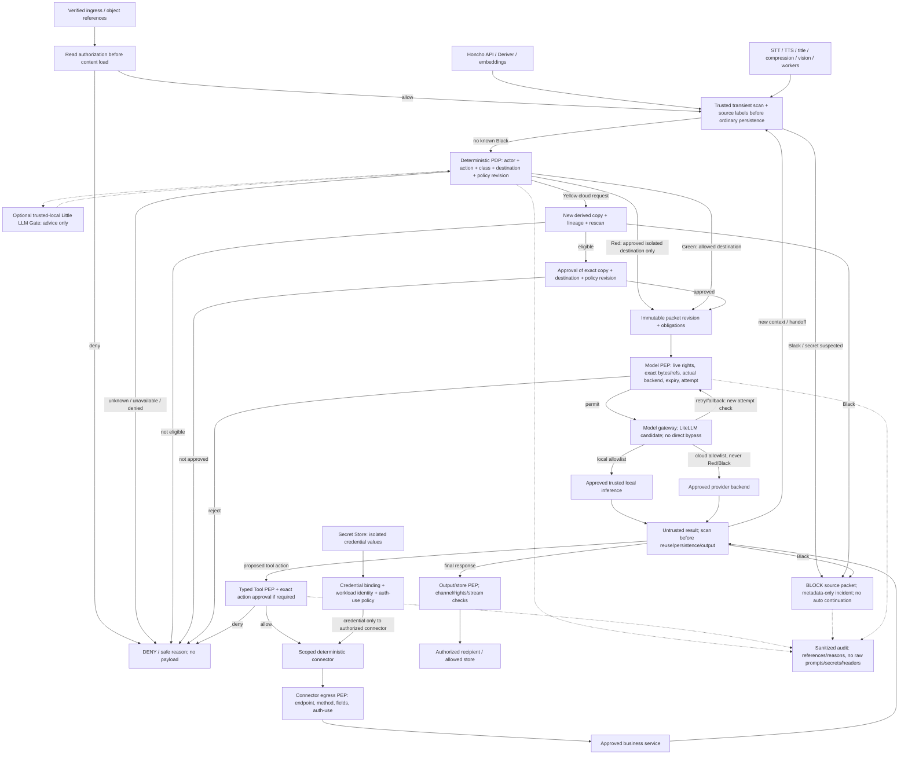

# Афина — запрос архитектурных изменений ACP-SEC-001

Редакция: 1. Дата: 05.11.2026. Статус: PROPOSED. Approver: Андрей. Решения не приняты.

## Содержание

1. Паспорт запроса архитектурных изменений
2. Реестр архитектурных решений для согласования
3. Нормативные инварианты и классы данных
4. Целевая интеграционная схема
5. Реестр изменений: спецификации и основные границы
6. Реестр изменений: данные, сеть, voice и приёмка
7. Модель данных и контракты допуска
8. Критические совместимости и ограничения baseline
9. Секреты, сеть и контейнерное размещение
10. Матрица обязательных испытаний
11. Фазы реализации и безопасный откат
12. Риски, альтернативы и незакрытые решения
13. Лист согласования и границы полномочий
14. Источники, редакции и согласуемые артефакты

## 1. Паспорт запроса архитектурных изменений

АФИНА • ACP-SEC-001 • Редакция 1 • 05.11.2026 • Статус: PROPOSED / НА СОГЛАСОВАНИИ

> Подготовка этого пакета не означает его принятия. Решения D01–D10 пока не утверждены; дата/ссылка подтверждения отсутствуют. Реализация, серверные изменения, выдача credentials и платные вызовы не выполнялись и этим документом не разрешаются.

### Цель

Восстановить явный сквозной security/routing контур из reference architecture v1.4 и интегрировать его с принятой функциональной архитектурой 3.3 и алгоритмом авторизации A02. Это дополнение ADD-SEC-001 к 3.3 для review, не автоматическая редакция 3.4.

### Сохраняется без пересогласования

Hermes как личная Афина; Honcho как long-term memory; независимый Catalog/Warehouse; проектные Team Control/Project DB/workers; voice pipeline с отдельной delivery. Принятый embedding route/model1536 не меняется. Framework команды, main LLM, provider auth, доверенная local площадка и paid voice остаются отдельными решениями.

### Основания и текущий предел доказательств

S1: архитектура 3.3. S2: приложенный PDF security v1.4. S3: приложенный MMD. S4: сравнительный анализ этой ветки и чтение r2 на коммите 10a86aac86322f7640037566913d380412478c7d. r2 имеет hardening/deployment checks, но не подтверждает реализацию сквозных Gate/PDP/LiteLLM/egress mechanisms.

### Что просим согласовать

Архитектурные обязательства, границы и набор проверок. Конкретные продукты, versions/images, migration scripts, network rules, performance budgets и change windows проходят последующее implementation/release согласование.

## 2. Реестр архитектурных решений для согласования

| ID | Решение | Предлагаемая формулировка |
| --- | --- | --- |
| D01 | Объединённая security architecture | Сохранить Core/Honcho/Team/Catalog/voice и A02; добавить data-classification и packet/egress enforcement. Объём: Обязательное направление |
| D02 | Классы и trust zones | Black: stop AI/content path; Red: approved isolated zone only; Yellow: local default, cloud для отдельной допущенной копии; Green: only approved route; unknown не Green. Объём: Обязательное направление |
| D03 | Policy authority и enforcement | Детерминированный PDP, обязательные PEP перед моделью, tool, storage и выдачей; ошибка/отсутствие gate не дают permit. Объём: Обязательное направление |
| D04 | Model gateway | Обязательная роль model-egress gateway; LiteLLM основной кандидат. Точная версия/provider auth/hooks/fallback требуют отдельного compatibility gate. Объём: Архитектурная роль; продукт условно |
| D05 | Tools и credentials | Typed connector boundary; credential ref вместо значения в AI-контексте; отдельный explicit профиль штатного authentication-use. Объём: Принцип; детали credential-use отдельно |
| D06 | Полное покрытие inference | Hermes, auxiliary, Honcho API/Deriver, embeddings, STT/TTS, workers используют одни обязательные ограничения. Принятый embedding1536 сохраняется. Объём: Обязательное направление |
| D07 | Security metadata и approvals | Расширить собственные metadata/ledger, создать packet/assessment/decision/incident refs; не менять native Hermes/Honcho schemas. Объём: Own schemas — design review |
| D08 | Сеть и контейнерные границы | Убрать неконтролируемые обходы model egress/секретов; выделить границы gateway/connector; не четыре контейнера по цветам. Объём: Топология — отдельный change review |
| D09 | Little LLM Gate | Опциональный локальный advisory-компонент; не может permit/declassify/override baseline; не блокирует разработку deterministic security. Объём: Опционально; можно отложить |
| D10 | Приёмка и governance | Только tested fail-closed/negative/failure tests + owner acceptance exact release. Architecture approval не execution authorization. Объём: Обязательное направление |

Для каждого ID фиксируется отдельный результат: ACCEPTED / ACCEPTED_WITH_CONDITIONS / DEFERRED / REJECTED; approver, дата, revision пакета, условия и evidence refs. Пока все D01–D10 — PROPOSED. Отсутствие ответа не согласие.

## 3. Нормативные инварианты и классы данных

| Класс | Предлагаемое обязательство | Не является разрешением |
| --- | --- | --- |
| Black | Запрет raw secret values в LLM, RAG, обычной памяти, Git/artifacts, tool payload/results и ordinary logs. Исходный AI/content packet остановить; incident metadata only. | Даже local LLM, fallback или формальное action approval не обходят запрет. |
| Red | Обработка только внутри утверждённого изолированного trust boundary; перечень hosts/endpoints/stores утверждается отдельно. | localhost, свой VPS, контейнер или наличие VPN не доказывают доверенный режим. |
| Yellow | Local по умолчанию. Cloud только для отдельной пригодной производной копии с lineage, scan и точным destination-bound approval. | Redaction не понижает класс исходника; отсутствие находок scanner не означает Green. |
| Green | Разрешённые local/cloud destinations в рамках action grants, budgets и channel policy. | Не право на запись/отправку/merge/delete и не допуск любому provider. |
| Unknown / mixed | Отсутствие надёжной classification не даёт permit. Смешанный пакет наследует все применимые ограничения; несовместимые ограничения → block/review. | Не выбирать Green по confidence LLM; не складывать произвольные privacy scopes в один пакет. |

### Дополнительные обязательства

• Один и тот же пакет проверяется на фактический model attempt/backend, а не только при старте turn. Retry/fallback не расширяет allowed set.

• Read permission, external-processing permission, credential-use и approval действия — разные проверки.

• Неизвестный исход не превращается в разрешённый повтор. Exact approval одноразово связывается с operation; повтор читает outcome.

• Input/RAG/tool/model result проходят контроль до следующего prompt, обычного сохранения и output. Нельзя обещать ретроактивную защиту данных, уже отправленных в Telegram/cloud.

• Security-контроль не требует одного контейнера на каждый цвет и не делает LLM источником полномочий.

## 4. Целевая интеграционная схема

Схема — целевая граница доверия. Model Gateway и Connector Egress решают разные задачи: первый проверяет model payload/backend, второй — точную бизнес-операцию и адресное authentication-use. Shared PDP не означает общий unrestricted доступ к payload или secrets.

В редактируемом MMD stages разведены явно: input assessment, model permit, result handling, tool authorization, output/store permit. Обычный DENY не автоматически Black incident. Нет безусловного перехода Policy Engine→execution в обход нужной стадии.

> Обязательные hooks не считаются защитой по факту подключения. До приёмки нужны доказательства fail-closed при exception/timeout/missing plugin, покрытие actual provider attempts/auxiliary calls и отсутствие direct bypass. Streaming: post-call/during-call без проверенного buffering не считаются предотвращением уже произошедшей утечки.

## 5. Реестр изменений: спецификации и основные границы

| CR / решения | Сейчас → предлагается | Где / проверка |
| --- | --- | --- |
| CR01 D01,D03 | Общие privacy/A02 без полной enforcement-линии → Единая policy/state model и инварианты | Spec3.3 §§4–8/17/27/31 + SYS draft/A02 SEC01–SEC16 |
| CR02 D02,D07 | Нет принятой classification schema в r2 → Source labels, наследование, unknown, derivative lineage | Own Artifact/Message/Context metadata SEC02/03/05 |
| CR03 D03 | Deployment preflight проверяет resources/mounts → Отдельный per-packet scan и decision stage | Ingress/context/model/tool/output adapters SEC01/06/11 |
| CR04 D03 | A02 как проект алгоритма → Authoritative decisions, obligations, dispatch re-check | Policy module + service PEPs SEC06/08/13 |
| CR05 D04,D08 | runtime_egress; gateway не реализован → Approved packet/attempt/backend enforcement | Gateway + provider adapters SEC04/06/07 |
| CR06 D05,D08 | SSH executor и file secrets — заготовки → Typed action PEP, exact approval, scoped connector credential | Tools/adapters/secret binding/network SEC08/09 |
| CR07 D03,D08 | Проверка до persistence не доказана → Доверенная проверка до обычной долговечной истории; ограниченный transient/quarantine path | Channel/history/context boundary SEC01/10/11 |
| CR08 D06 | Прямой inference_egress API/Deriver → Не отправлять Red/Black в cloud pipeline; покрыть все derived calls | Memory ingest/provider adapter/egress SEC03/12 |

Полный машинно-читаемый реестр из 16 строк включён в CSV: status, фаза, зависимости, baseline/target и tests. Каждая строка пока PROPOSED. «Сейчас» описывает документы/код r2, не активную конфигурацию VPS.

## 6. Реестр изменений: данные, сеть, voice и приёмка

| CR / решения | Сейчас → предлагается | Где / проверка |
| --- | --- | --- |
| CR09 D06 | Отдельные прямые provider paths возможны → Classify text/audio/context; egress каждый вызов; output buffering policy | Voice/STT/title/compression/vision adapters SEC07/12 |
| CR10 D02,D07 | Минимизация как принцип → Отдельная immutable copy + scan + destination-bound approval | Packet builder + Catalog + approvals SEC05 |
| CR11 D07 | Entities ещё не приняты → Packet/Scan/Decision/Attempt/Incident refs; reuse existing approvals | Own security/operation ledger SEC13/15 |
| CR12 D08 | Agent/provider clients могут иметь egress и upstream keys → Доказуемый no-bypass; gateway/connector egress по назначениям | Compose core/honcho/team + network policy SEC04/09 |
| CR13 D03,D07 | Metadata-only audit и privacy требования → Проверка до выдачи chunk/записи/индексации; policy-bound caches | Channel/stream/memory/logging boundaries SEC07/10/14 |
| CR14 D09 | Не реализован → Откладываемый trusted-local analysis-only helper | Optional local inference adapter SEC16 |
| CR15 D02,D08 | Trusted local inference route не определён → Без approved backend Red blocked; no cloud fallback. Local-backend ADR отдельно | Trust-zone/endpoint registry SEC03 |
| CR16 D10 | Защитные шаблоны не end-to-end evidence → Negative/timeout/retry/stream/revoke/restore tests до acceptance | Tests/evidence/release manifest SEC01–SEC16 |

### Минимальная область воздействия

Меняется security plane и способы доступа, не основные бизнес-роли Hermes/Honcho/Team/Catalog. На runtime/worker стороне исчезают неконтролируемые upstream keys/egress там, где это необходимо для anti-bypass. Контейнерная и credential топология будет отдельным reviewed diff, без массовой замены или удаления текущих файлов.

## 7. Модель данных и контракты допуска

| Логический объект | Поля / ссылки для schema review | Reuse / ограничения |
| --- | --- | --- |
| DataClassification | subject_ref/revision, class, provenance, authority, policy_revision, validity | Расширять own metadata. Не доверять одному model label; inheritance определяет policy. |
| ScanAssessment | subject_digest/ref, scanner_version, coverage, reason_codes, assessment_state | No secret values; scan coverage явно неполное; encoding/OCR/archive учесть. |
| PacketRevision | immutable context/refs, lineage, class/scope, requested purpose/destination | Payload в разрешённом store; не копировать полный prompt в audit. |
| PolicyDecision | actor/workload, operation, action/packet digest, obligations, permitted destinations/aliases, version/expiry | Развивает A02; decision replay/revoke проверяются непосредственно перед effect. |
| PacketApproval | exact packet/copy revision, destination/route, policy revision, approver, conditions | Специализация существующего approval. Не заменяет action approval. |
| ModelAttempt | operation_ref, decision_ref, requested/effective backend, fallback_parent, outcome/receipt | Расширить operation/usage ledger; per-attempt egress обязательно. |
| CredentialBinding | secret_ref, workload identity, approved endpoint/method/purpose, lifecycle | Никаких raw credentials в own metadata или prompts. |
| SecurityIncident | incident_ref, source ref, type, safe metadata, disposition/review refs | Ordinary log не quarantine dump; metadata тоже access-controlled. |

Это логические objects, не восемь обязательных новых таблиц/сервисов. Не менять vendor-owned Hermes/Honcho schemas ради own fields. Цифровая подпись/opaque permit, keyed digests, retention, indexes, constraints и физический DB engine — отдельный schema/security review.

## 8. Критические совместимости и ограничения baseline

| Область | Условие принятия | Если условие не выполнено |
| --- | --- | --- |
| Hermes hooks/providers | Проверить pinned release: блокирующие точки, missing/exception/timeout semantics, retries/auxiliary/content persistence. Observer не PEP. | Дополнительный adapter/gateway/network boundary или блокирование affected feature; не заявлять enforcement. |
| LiteLLM candidate | Проверить native provider auth/protocol, exact attempts/fallback, guardrail timing, logging и streams. pre_call до сети; callback не единственная защита. | Другой совместимый gateway/adapter через ADR. Не ломать OAuth/Codex путь обходным хранением токенов. |
| Honcho API/Deriver | Policy на ingest и derived inference; Red/Black не уходят в OpenRouter pipeline. Принятый embedding1536 сохраняется. | Red memory blocked; local-only memory/новое embedding пространство только отдельным ADR. |
| Local Red execution | Утвердить actual isolated host/backend, operator/egress/telemetry/storage/backup boundaries и capability. | Red blocked/deferred. Не покупать GPU/новый VPS этим approval и не fallback cloud. |
| STT/TTS/vision/auxiliary | Учесть исходное audio/image и все последующие data forms; channels/destinations и retention. | Не включать affected external-processing route для неподходящих данных. |
| Stores/history/cache | Зафиксировать до каких записей выполняется check; carry labels across sessions, derived context, cache и background jobs. | Не считать pre-LLM hook достаточным; нет допуска чувствительных данных в непроверенный persistence path. |

Согласование направления не доказывает совместимость конкретного software release. Полный scanner/DLP без false negatives не обещается. Угроза компрометации host/root/Docker admin требует отдельного усиления и не устраняется labels или plugin hooks.

## 9. Секреты, сеть и контейнерное размещение

### Разделяем две политики

1. Secret values запрещены в AI/content pipeline. 2. Штатное authentication-use возможно только по явно утверждённому профилю: конкретная workload, secret ref, endpoint/method/purpose, срок и lifecycle. Если владелец требует абсолютного запрета передачи секрета наружу, маршрут, которому нужна такая передача, блокируется.

Приватный signing key может оставаться в signer, а bearer token по утверждённой операции используется в Authorization соответствующего сервиса. Это не исключение для model prompt и не blanket право коннектора отправлять любые секреты. Реальные endpoints/credentials этим документом не разрешены.

### Предлагаемые логические deployment units

| Unit | Ответственность | Что согласуется позже |
| --- | --- | --- |
| Runtime/workers | Работают с refs/typed operations; no bypass upstream credentials/model egress | Точный перечень сетей, mounts, providers, tool families. |
| Security authority | Deterministic policy + assessment/registry; можно стартовать как единый trusted module | Engine/product, code isolation, trusted data roots, fail-closed integration. |
| Model gateway | Маршрутизация только допустимых attempts/backends; LiteLLM candidate | Image/version/auth, adapters, per-attempt policies, buffer/latency budgets. |
| Connector boundary | Typed authorized business calls; адресные credentials | Workload identity, endpoint policies, credential rotation/expiry, output/error scrubbing. |
| Trusted local backend | Опциональный approved inference path для Red/Yellow | Хост/ресурсы/лицензии/telemetry/egress и стоимость отдельным ADR. |

Не отключать runtime весь интернет без inventory: Telegram/approved services требуют собственных путей. Не добавлять по контейнеру на каждый цвет. Число новых services/ресурсов ещё не зафиксировано; существующие DB не переносить и диски не менять по этому пакету.

## 10. Матрица обязательных испытаний

| ID | Сценарий | Критерий |
| --- | --- | --- |
| SEC01 | Secret canary в task/file/RAG/tool-result | Не достигает local/cloud LLM, ordinary history/index/logs; incident safe. |
| SEC02 | Unknown / mixed / model downgrading | Unknown не Green; ограничения источников сохраняются; model не даёт permit. |
| SEC03 | Red при local failure / Honcho cloud path | Ни одного cloud attempt; affected task explicitly blocked. |
| SEC04 | Direct shell/MCP/browser/provider bypass | Неразрешённый egress/credential access невозможен в проверенной threat model. |
| SEC05 | Yellow copy/version/destination mutation | Отдельный lineage; stale/changed packet approval не применим. |
| SEC06 | Gate missing / exception / timeout / engine outage | Нет защищённого effect; ошибка не превращается в unrestricted request. |
| SEC07 | Streaming / during-call / retry/fallback | Необработанный chunk не раскрывается; каждый actual attempt имеет допуск. |
| SEC08 | Action approval и конкурентное использование | Packet permit не authorizes write/delete/send; exact operation/revision binding. |
| SEC09 | Connector secret lifecycle и injection | Credential только bound workload/destination; no secret in args/results/errors/logs. |
| SEC10 | Output/store/channel policy | Нет неподходящей записи/доставки; labels сохраняются в cache/session. |
| SEC11 | Ingress persistence order | Raw canary не записывается до intended check в обычную native history/traces. |
| SEC12 | Derived/auxiliary call coverage | Honcho API/Deriver/embeddings/STT/TTS/title/compression/vision/worker calls не обходят policy. |
| SEC13 | Revoke / stale policy / restore / UNKNOWN | Stale decision не permit; reconcile до replay; duplicate effect не создаётся. |
| SEC14 | Sensitive cache/result replay | Live ACL/rights/policy проверяются перед выдачей прежнего результата. |
| SEC15 | Schema/retention/recovery | Own schema restores; no upstream DDL patch; audit/quarantine/backup access корректен. |
| SEC16 | Advisory Gate error/compromise | Ни permit, ни declassification, ни bypass; optional module не authority. |

Статус всех SEC01–SEC16: NOT_TESTED. Synthetic markers, не реальные секреты. Evidence связывается с exact source/image/config/policy/provider revisions. SEC16 применяется только при реализации D09. Неиспытанное нельзя отметить PASS.

## 11. Фазы реализации и безопасный откат

| Фаза | Выходной результат | Gate |
| --- | --- | --- |
| P0 · Policy / design | Принятые D-решения, labels/trust-zone definitions, complete outbound/persistence inventory, threat model. | No provider/secret/network changes в рамках design approval. |
| P1 · Deterministic pilot | PDP/PEP, ingress/scan, model/connector boundaries и own ledger; synthetic requests only. | Fail-closed и anti-bypass evidence по pinned implementations. |
| P2 · Full integration | Honcho/voice/auxiliary/workers, Yellow copies, output/store checks и candidate deployment diffs. | Все применимые SEC tests + compatibility/migrations/restore evidence. |
| P3 · Optional local/advisory | Local Red backend / Little LLM Gate при отдельных ADR, ресурсах и бюджете. | Нет обязательной зависимости от малого классификатора; SEC16 по применимости. |
| Release | Owner accepts exact verified release + отдельно утверждённое окно эксплуатации. | Deployment/credentials/платные вызовы согласованы конкретно, не этим документом. |

### Откат не должен ослаблять policy

При несовместимости можно вернуть предыдущий проверенный код для допустимого класса данных либо отключить затронутую функцию. Нельзя восстанавливать прямой cloud bypass или отключать проверку как «временный rollback». Неизвестные внешние effects остаются UNKNOWN до reconcile. Schema rollback зависит от совместимости; деструктивные миграции и удаление прежних данных не предполагаются.

### Влияние на полезную автономность

Внутри заранее утверждённого action/scope/data-route Афина действует без вопроса на каждую строку. Human approval нужен при выходе за policy/изменении точного действия, для Yellow-egress и иных explicitly required conditions. Отказ optional команды/voice не блокирует безопасный обычный диалог.

## 12. Риски, альтернативы и незакрытые решения

| Риск / альтернатива | Предлагаемая обработка |
| --- | --- |
| False positive / false negative scanner | Не считать scan proof отсутствия sensitive data; source labels, минимизация и anti-bypass дополняют screening. Incident review; no auto class downgrade. |
| Latency / сложность / единая точка отказа | Измерить отдельно; bounded buffers/cache approved decisions с revoke/version checks; недоступность обязательной authority не открывает доступ. |
| Неподдерживаемая provider auth схема | Не force-switch main model или OAuth. Compatibility ADR до gateway promotion; альтернативный поддерживаемый adapter при review. |
| Доверие host/root | Управляемые boundary process/network/credential права не защищают от полного host compromise; threat model/host hardening отдельно. |
| Нет local inference | Не имитировать Red support. Green/eligible Yellow могут использовать разрешённый cloud; Red remains blocked. |
| Покупка оборудования/сервиса | Не включена в ACP. Требуется отдельное обоснование ёмкости, цены, допустимости и approval. |
| Сохранить r2 без security plane | Можно продолжать design и synthetic непроизводственные tests; нельзя заявлять нужную защиту чувствительных данных. |
| Внедрить только Little LLM Gate | Отклонить как достаточное решение: model advice не authorization/egress enforcement. |

### Открыто до implementation approval

Pinned releases, compatibility contracts, classification taxonomy details, exact gateway engine и auth, workload identity, streaming buffering, numeric latency/bytes/concurrency/retry/retention limits, own DDL/indexes, credential-use profiles, threat model и trust zones. Unknown не заполняется вымышленным digest/model/UUID/endpoint.

## 13. Лист согласования и границы полномочий

Пакет: ACP-SEC-001 • revision 1 • Статус на момент выпуска: PROPOSED. Владелец/approver: Андрей. Дата решения: НЕ ЗАДАНА. Ссылка на подтверждение: НЕ ЗАДАНА.

| Решения | Текущий статус | Условия / комментарий владельца |
| --- | --- | --- |
| D01 | PROPOSED | Не заполнено |
| D02 | PROPOSED | Не заполнено |
| D03 | PROPOSED | Не заполнено |
| D04 | PROPOSED | Не заполнено |
| D05 | PROPOSED | Не заполнено |
| D06 | PROPOSED | Не заполнено |
| D07 | PROPOSED | Не заполнено |
| D08 | PROPOSED | Не заполнено |
| D09 | PROPOSED | Не заполнено |
| D10 | PROPOSED | Не заполнено |

### Предлагаемая форма ответа

«ACP-SEC-001 r1: D01=…; D02=…; …; D10=…. Условия: …. Отдельно подтверждаю/не подтверждаю направление credential-use D05. D09 можно отложить. Разрешение на реализацию и эксплуатационные действия этим ответом не выдаю».

### Что даёт архитектурное согласование

Фиксирует целевые инварианты и направление дальнейшего проектирования; позволяет готовить конкретные proposals/diffs/тесты. Не назначает VERIFIED/ACCEPTED реализации, не выбирает автоматически products/releases или code/provider models.

### Что не разрешается автоматически

• Запись в GitHub, merge/push/release, изменение серверных файлов, firewall/сетей, перезапуск сервисов и миграции БД.

• Выдача/загрузка/отзыв токенов, передача PEM и работа с реальными credentials.

• Отправка реальных Red/Yellow данных, платные synthesis/inference calls, покупка тарифов/GPU/VPS.

• Удаление/перезапись исходников, backups, схем, history и существующих данных.

> ACCEPTED_WITH_CONDITIONS не заменяет gate evidence. Изменившиеся реализация/action/payload/destination требуют нового соответствующего решения. Никакие решения не отмечены принятыми в этом пакете.

## 14. Источники, редакции и согласуемые артефакты

### S1 · Athena_2_0_Current_Specification_v3_3.md

SHA-256: 181f1f20f318ca63493756bbc2a5777ffddcec682160ee32603771b1391df6cd

### S2 · athena_architecture_specification_ru_v1_4.pdf

SHA-256: f95e9cca4f5997cecb8396d04ffda903c24c8bf463b0c89309529b18433dfff4

### S3 · athena_security_architecture_v1_4.mmd

SHA-256: dcf3baf6822512937ef598636bcf4c0dcf909315f0283d2579ed604d0c220888

### S4 · Сравнительный анализ текущей ветки

Использованы результаты чтения r2 на Git commit 10a86aac86322f7640037566913d380412478c7d: compose.core.yaml, compose.honcho.yaml, preflight.py, hermes.config.yaml.example и список файлов. Сверка подтверждает candidate configuration, не установленный enforcement. Аудит VPS этим пакетом не выполнялся.

### Публичные engineering references из анализа

Hermes hooks: https://hermes-agent.nousresearch.com/docs/user-guide/features/hooks
LiteLLM custom guardrail: https://docs.litellm.ai/docs/proxy/guardrails/custom_guardrail
LiteLLM callbacks: https://docs.litellm.ai/docs/observability/custom_callback
OWASP Prompt Injection Prevention: https://cheatsheetseries.owasp.org/cheatsheets/LLM_Prompt_Injection_Prevention_Cheat_Sheet.html

Эти ссылки иллюстрируют compatibility hazards, но не подменяют pinned-source review. Внутренние memory:* ссылки исходного reference PDF — его исторический provenance, не заново проверенные доказательства кода.

### Состав пакета

1. PDF для чтения и согласования. 2. Markdown с тем же содержанием. 3. CSV change register CR01–CR16. 4. MMD целевой схемы. Все — revision 1 / PROPOSED; нет deployment config, credentials, executable migrations или новых policy grants.
