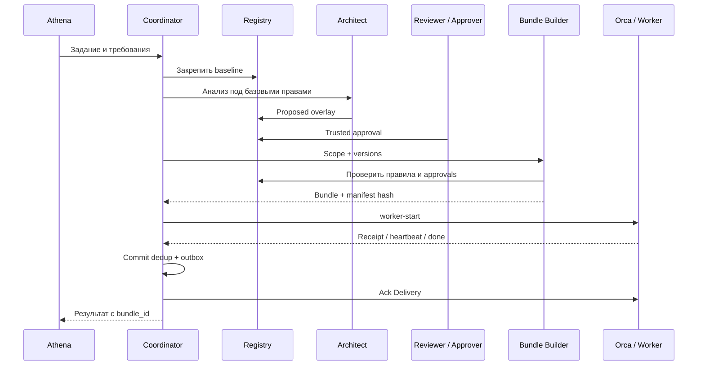

# Athena / Orca: Blueprint и runbook
Дата: 26.10.2026. Статус: reference prototype, не production deployment.

## Источники
- https://opencode.ai/docs/rules/
- https://www.onorca.dev/docs/cli/orchestration

## Архитектура
### Архитектура
Beget: Athena и решения пользователя → защищенный канал → HostHatch: адаптер, policy registry, builder/validator, Orca и OpenCode workers. Ноутбук — только клиент. Базовый регламент и approvals защищены от записи работников.

### Память
Нормативная: утвержденные правила. Фактологическая: проверенные сведения с provenance. Эпизодическая: результаты и инциденты. Операционная: Task/Dispatch и ожидания. Факты и документы не повышаются до инструкций автоматически.

### Изоляция
Global — чтение для всех утвержденных ролей. Project — только участникам проекта. Task — конкретным попыткам. Secrets — вне памяти и prompts. Worktree разделяет файлы, но не пользователя ОС и сеть. Для недоверенного кода нужны отдельные users/containers и credentials.

### Синхронизация
Один writer registry. Immutable revisions и pinned bundle. Delivery → транзакционная дедупликация + локальный outbox → ack → исполнение intents. Внешний запуск не атомарен с БД: потерянный receipt требует reconcile, не слепого повтора. Revocation блокирует новые Dispatches; активные останавливаются по процедуре, не через надежду на hot reload.

### Конфликты
Scope-фильтрация → только approved → проверка authority → deny-first для точного resource/action → конфликты require → ручная эскалация свободного текста. Lower layer не расширяет baseline. Исключения отдельные, конкретные и срочные; builder не принимает самопровозглашенное approval от архитектора.

### Внедрение
1. Зафиксировать версии и проверить live Orca skill. 2. Развернуть read-only registry. 3. Ввести trusted approvals. 4. Собрать bundle. 5. Подключить instructions OpenCode. 6. Проверить роль и права. 7. Выполнить один Dispatch. 8. Испытать потерю связи, повтор Delivery и отзыв правил.

## Схема правила (собственный контракт)
```json
{"rule_id":"GLOBAL.DELETE","revision":1,"layer":"global","project_id":null,"task_id":null,"roles":["*"],"status":"approved","effect":"deny","resource":"workspace","action":"delete","statement":"Не удалять без отдельного подтверждения"}
```
Полная JSON Schema внедряется отдельно. Подтверждение не доверяется полю status из worker-payload: approvals хранятся отдельно в управляемом registry. Для require условия проверки должны быть типизированы; свободный текст требует review.

## Sequence


## Context injection
Подключать baseline/project/task через instructions в изолированной конфигурации OpenCode; role — через prompt профиля агента. Проверить фактический выбор роли: --agent opencode в Orca выбирает CLI, не наш custom role. Сверить live skill, не выдумывать флаги. Проверить глобальные AGENTS.md и совместимые CLAUDE.md. Не использовать удаленный mutable main. Чтение по ссылке Markdown не равно загрузке instructions.

## Storage и синхронизация
Registry: версионируемые immutable revisions. Журнал: tasks, dispatches, bundles, deliveries, decisions, outbox. Один управляющий writer. Bundle pin на каждую попытку. Не копировать живую SQLite-базу между VPS. Каждая Delivery применяется транзакционно с дедупликацией; после commit — ack. Внешние команды исполняются через outbox с явным UNKNOWN outcome при потерянном ответе. Нельзя обещать exactly-once.

## Runbook
1. Отдельный управляющий пользователь; workers не пишут registry/approvals.
2. Зафиксировать Orca/OpenCode версии; проверить orca status --json и orca skills get orchestration --full.
3. Сохранить глобальный baseline и роли под Git; review изменений.
4. Architect создает только proposals; Approver публикует отдельную запись approval.
5. Прогнать prototype ниже: python governance_demo.py. Это stdlib-only offline demo.
6. Убедиться: global deny включен, approved project require включен, proposed исключен.
7. Проверить negative case: попытка approved allow поверх global deny отклоняется.
8. Подключить файлы собранного bundle к OpenCode; проверить запуск на безопасной задаче.
9. Настроить журнал и Delivery/outbox; сначала один worker, затем два.
10. Проверить shutdown ноутбука, restart адаптера, повтор события и отзыв правила.

## Ограничения Python demo
Не JSON-Schema validator, не IAM, не полная система памяти, не Orca adapter. Проверяет ограниченную модель точных resource/action, scope, trusted digest approvals и deny escalation. Не поддерживает exceptions, wildcard resource, expiry, semantic conflict analysis и distributed leases; они требуют отдельной реализации. Хеш не является подписью. В production trusted approvals и код builder должны быть недоступны workers.

## Память
Факт: источник, commit, verification_status, срок актуальности. Эпизод: входы, действия, результат, limitations. Операционное состояние: IDs, lease/heartbeat, pending decision. Нормативные правила выбираются детерминированно, не только RAG. Межпроектный retrieval закрыт по умолчанию, доступ задается principal/project/task до поиска, а не фильтруется только после генерации.

## Приемка
- Нельзя включить proposed или revoked.
- Нельзя подменить approved rule сохранив approval на старый digest.
- Правило другого проекта не попадает в bundle.
- Нельзя ослабить baseline grant-правилом.
- Новый bundle не меняет активные dispatches незаметно.
- Secrets не попадают в artifacts и retrieval.
- Read-only snapshot не объявляется security boundary при том же unrestricted user.
- Retry запуска сначала сверяет предыдущий Dispatch.
